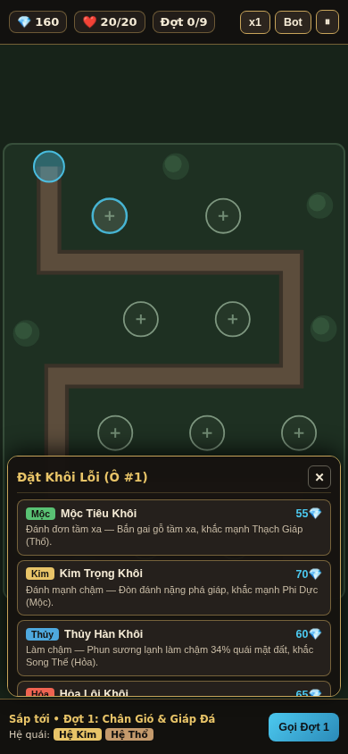
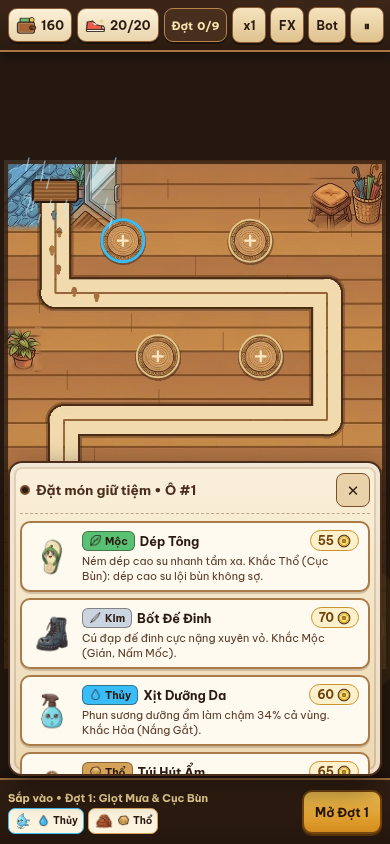
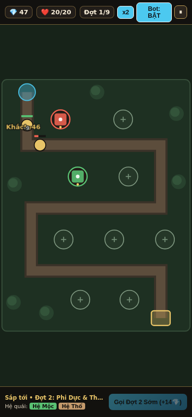
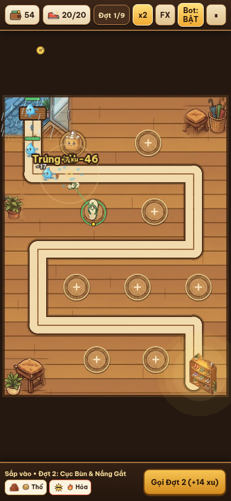
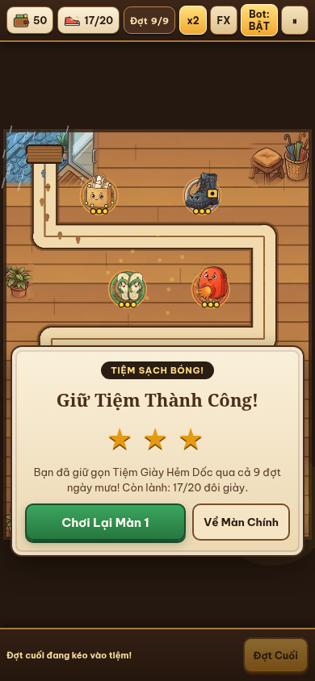

LÀM ĐẸP XONG

# Tiến độ phát triển — Gọn Tiệm, Sạch Phố ("Ngũ hành giữ tiệm")

Cập nhật: 22/11/2026 • Nhánh: `main` • Trạng thái hiện tại: **Đã hoàn thành đổi chủ đề & làm đẹp Màn 1 "Tiệm Giày Hẻm Dốc" (Bước B, C, D theo `docs/ANTIGRAVITY_BRIEF_LAM_DEP.md` & `docs/CHU_DE_GIU_TIEM.md`), giữ nguyên mục tiêu độ khó; chưa làm Màn 2–3, tương sinh và bậc 4.**

---

## 1. Năm góp ý từ `docs/REVIEW_LOG.md` đã làm đủ

1. **Nền trong suốt sạch cho mọi món & quái:** Toàn bộ 5 món giữ tiệm và 6 quái (+ Gián Con + Trùm Mùa Nồm) được tách nền trong suốt hoàn toàn (BFS flood-fill + gọt halo mép ngoài), kiểm tra trên nền caro không còn dính nền cũ hay viền trắng.
2. **Vẽ lại Con Gián đúng dáng gián hoạt hình dễ thương:** Thân dẹt bầu dục, cánh nâu bóng xếp chồng, đúng 2 râu dài uốn cong, 6 chân mảnh có gai nhỏ và đôi mắt tinh nghịch (không còn giống bọ cánh cứng tròn).
3. **Bỏ chữ "WELCOME" trên thảm chùi chân:** Cửa tiệm góc trên-trái dùng thảm chùi chân nâu sọc sạch, không có chữ nước ngoài.
4. **Nền bản đồ Màn 1 khớp 100% đường quái đi & 9 ô đặt món:** Bản đồ [`public/assets/map_man1_tiem_giay.webp`](../public/assets/map_man1_tiem_giay.webp) (`720×960` = đúng 2× khung `360×480`) ghép sàn gỗ thông ấm, góc vỉa hè đá ướt mưa, ghế thử giày, giỏ ô, kệ giày gỗ ở cuối đường `(304, 455)`, đường đi màu kem khớp chính xác 8 điểm nút `STAGE_1_DEFINITION.paths[0]` và 9 thảm cói tròn nằm đúng toạ độ 9 ô `STAGE_1_DEFINITION.pads` (rõ nét, không bị che khuất trên điện thoại cầm dọc).
5. **Nén Atlas WebP, tổng dung lượng `dist/` ≤ 5 MB:**
   - `dist/assets/gon_tiem_atlas.webp` (104 khung hình, `1024×944`): **276 KB**
   - `dist/assets/gon_tiem_atlas.json`: **18 KB**
   - `dist/assets/map_man1_tiem_giay.webp`: **49 KB**
   - Phông chữ tiếng Việt offline (`Be Vietnam Pro` + `Noto Serif`, `.woff2`): **89 KB**
   - Mã game + Phaser (`index-*.js` + CSS): **1.56 MB**
   - **Tổng thư mục `dist/`:** **2.0 MB** (dưới rất xa ngưỡng 5 MB).

---

## 2. Chi tiết đã làm theo `docs/ANTIGRAVITY_BRIEF_LAM_DEP.md`

### Đổi tên & gán lại Ngũ Hành (`src/core/tdDefinitions.ts`, `src/core/elements.ts`, `src/core/tdEngine.ts`, `src/core/tdBot.ts`)
- **5 món giữ tiệm Màn 1 (đủ tên Bậc 1 → Bậc 2 → Nhánh A / Nhánh B đã duyệt):**
  - **Dép Tông (Mộc):** *Dép Tông Đế Dày* → *Dép Tông Kép (A)* / *Dép Tông Gai Bám (B)* — khắc **Thổ (Cục Bùn)**.
  - **Bốt Đế Đinh (Kim):** *Bốt Đinh Thép* → *Bốt Chốt Chì (A)* / *Bốt Đinh Quét Dọc (B)* — khắc **Mộc (Gián, Nấm Mốc)**.
  - **Xịt Dưỡng Da (Thủy):** *Bình Xịt Áp Lực* → *Xịt Bọt Tuyết Lạnh (A)* / *Xịt Vòi Xoáy (B)* — khắc **Hỏa (Nắng Gắt)**.
  - **Túi Hút Ẩm (Thổ):** *Giỏ Hút Ẩm Cỡ Đại* → *Thảm Hạt Hút Khô (A)* / *Chùm Túi Nổ Liên Hoàn (B)* — khắc **Thủy (Giọt Mưa)**.
  - **Máy Sấy Giày (Hỏa):** *Máy Sấy Hai Vòi* → *Máy Sấy Khử Khuẩn (A)* / *Máy Sấy Gió Nhiệt Cao (B)* — khắc **Kim (Chuột)** + hỗ trợ sấy khỏe món bên cạnh.
- **Quái Màn 1 gán đúng hành:** **Giọt Mưa (Thủy)**, **Cục Bùn (Thổ)**, **Gián / Gián Con (Mộc)**, **Nắng Gắt (Hỏa)** (cùng định nghĩa sẵn **Chuột — Kim**, **Nấm Mốc — Mộc**, **Trùm Mùa Nồm — Thủy**).

### Bước B — Đủ bộ Sprite & Atlas (`scripts/build_art_assets.py`, `public/assets/`)
- 5 món × 4 bậc/nhánh (có khác biệt hình ảnh rõ rệt ở Bậc 2, 3A, 3B) × **3 khung hoạt ảnh bắn** = 60 khung hình.
- 6 quái + Gián Con + Trùm Mùa Nồm × **4 khung hoạt ảnh đi** = 32 khung hình.
- Đạo cụ & biểu tượng: thảm cói tròn, kệ giày gỗ, 5 biểu tượng hành (giọt nước, cục đất, chiếc lá, mũi kim, ngọn lửa), tiền xu, chiếc ví, đôi giày lành, đạn dép tông & gói hút ẩm.

### Bước C — Hiệu ứng chiến đấu & không khí ngày mưa (`src/scenes/TdStageScene.ts`, `src/game/preferences.ts`)
- **5 kiểu đòn đánh riêng kèm bảng màu hành** (Thủy `#38bdf8`, Thổ `#d4a359`, Mộc `#59c173`, Kim `#cbd5e1`, Hỏa `#ff6b4a`): dép tông xoay vèo, bốt đạp sóng xung kích + bụi, xịt phun sương lam phủ vùng, gói hút ẩm bay cầu vồng bung hạt hút ẩm, máy sấy thổi luồng hơi ấm cam đỏ.
- **Hoạt ảnh & 6 hiệu ứng chết riêng:** món giật nảy + lóe sáng khi đánh; quái nhún khi đi + chớp trắng khi trúng; khi chết: Giọt Mưa bắn tóe nước, Cục Bùn vỡ vụn đất, Gián lật ngửa xoay tròn, Chuột quay đầu chạy biến, Nấm Mốc tan bụi bào tử, Nắng Gắt thu nhỏ tắt phụt.
- **Không khí Đà Lạt ngày mưa:** mưa rơi xiên ngoài cửa kính góc trên-trái, vũng nước lăn tăn, ánh đèn vàng ấm trên kệ giày cuối tiệm.
- **Phản hồi sướng tay:** chữ **"Trúng tủ!"** to nổi bật + rung nhẹ khi khắc chế; xu và tiền giấy bay vòng vào **Chiếc Ví** (nảy nhẹ khi nhận tiền); thắng màn có pháo sáng + 1–3 sao rơi lần lượt.
- **Tuỳ chọn "Giảm hiệu ứng" (`FX` / `Nhẹ`):** tự bật khi thiết bị đặt `prefers-reduced-motion: reduce`, có nút chuyển trực tiếp trên thanh trên và lưu vào `localStorage`.

### Bước D — Giao diện hộp giày / thẻ giá treo & Phông chữ tiếng Việt offline (`src/ui/styles.css`, `src/scenes/TitleScene.ts`, `src/assets/fonts/`)
- Khung hộp giày giấy kraft ấm có viền gỗ & nét khâu đứt, thẻ giá treo có lỗ xỏ cho bảng mở màn, bảng đặt món, bảng nâng cấp (hiện rõ hình ảnh từng nhánh 3A / 3B) và hộp tổng kết.
- Thanh báo đợt phía dưới hiển thị đồng thời **hình con quái + biểu tượng hành Ngũ Hành** của đợt sắp kéo vào tiệm.
- Cài sẵn offline 2 bộ phông tiếng Việt **SIL Open Font License 1.1**: **Be Vietnam Pro** (nội dung / nút) và **Noto Serif** (tiêu đề), không gọi bất kỳ tài nguyên mạng ngoài nào (xem [`CREDITS.md`](../CREDITS.md)).

---

## 3. Kết quả kiểm chứng cân bằng sau khi gán lại Ngũ Hành Màn 1

| Kiểm tra | Kết quả sau gán lại hành | Mục tiêu REVIEW_LOG |
|---|---|---|
| **Bot phối hợp đúng 5 hành (`sim_man1.ts`)** | **Thắng, còn 17/20 đôi giày (3 sao, mất 3 đôi)** | Đạt (thắng có mất vài mạng, không phải 20/20 dễ dàng) |
| **Lấp 9 ô toàn 1 món (`all` & `all-noupg`)** | **Thua cả 10/10 lần (0/20 đôi)** | Đạt |
| **Giới hạn 1–4 món đơn lẻ (`limit 1..4`)** | **Thua cả 8/8 lần (0/20 đôi)** | Đạt |
| **60 lần đặt ngẫu nhiên (`random-mix 60`)** | **Thắng 7/60 (11.7%), Thua 53/60, 0/60 lần 3 sao** *(lives: `5,5,6,6,7,10,14`)* | Đạt (≤ 30% thắng, hầu như không 3 sao) |
| **400 kế hoạch ngẫu nhiên (`search_man1.ts`)** | **Thua 187, 1 sao 73, 2 sao 94, 3 sao 46 — tốt nhất còn 20/20** | Đạt (3 sao vẫn đạt được khi tính kỹ, cách đặt quyết định thắng thua) |

---

## 4. Ảnh so sánh Trước / Sau trên điện thoại cầm dọc (`390×844`)

| Cảnh | Trước khi làm đẹp (`dep_*_truoc_*.png`) | Sau khi làm đẹp (`dep_*_sau_*.png`) |
|---|---|---|
| **1. Màn hình chính** |  |  |
| **2. Chạm ô đặt món** |  |  |
| **3. Giao tranh Màn 1** |  |  |
| **4. Thắng màn & Chấm sao** |  |  |

---

## 5. Lệnh kiểm tra nhanh

```bash
npm test          # 16/16 unit test qua
npm run build     # dist/ tổng cộng 2.0 MB (<= 5 MB)
npm run test:e2e  # 2/2 Playwright điện thoại dọc 390x844 qua, 0 lỗi console, 0 mạng ngoài
```
