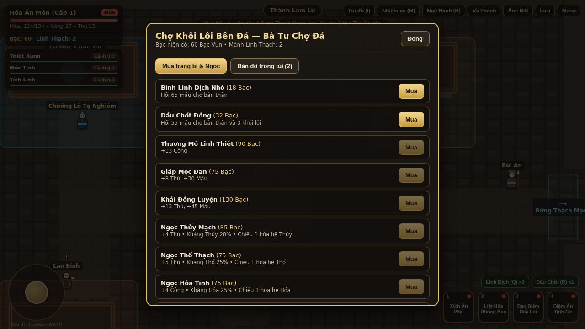
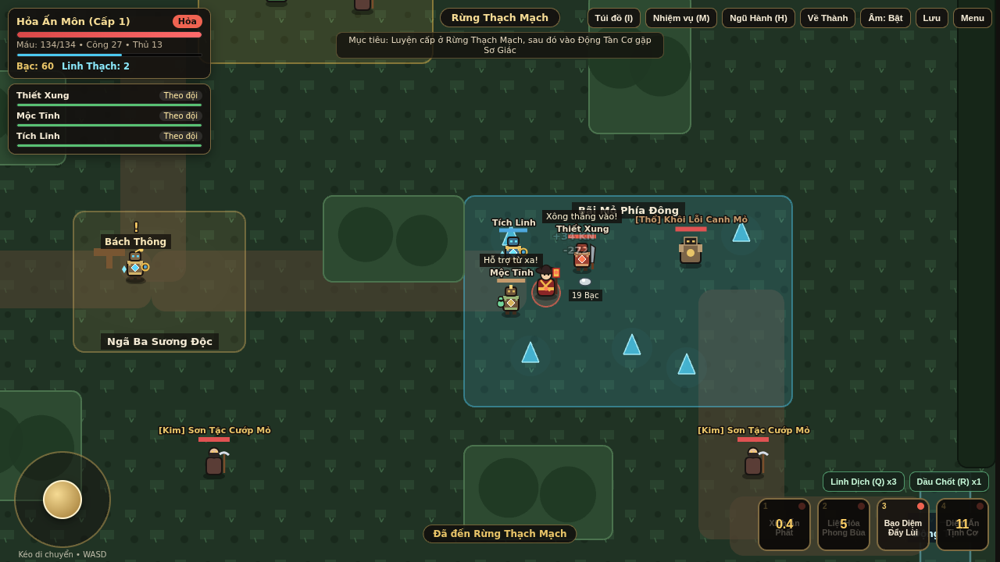
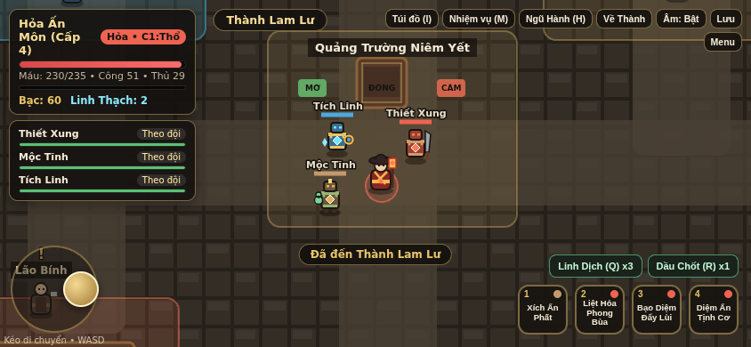

GĐ1 XONG

# Tiến độ phát triển — Giang Hồ AI (Giai đoạn 1)

Cập nhật: 22/11/2026 • Nhánh: `main` • Công nghệ: Phaser 3 + TypeScript + Vite (web tĩnh offline hoàn toàn trong `dist/`, không gọi mạng, không khoá API, không quảng cáo, không theo dõi).

---

## 1. Đã hoàn thành trong Giai đoạn 1

### Thế giới & 3 bản đồ (Phaser 3 Scene riêng biệt)
- **Thành Lam Lư** (`src/scenes/TownScene.ts`, khu an toàn tự hồi máu):
  - **Lò Đúc Chấn Cơ** (lửa linh thạch xanh lam cháy thâu đêm) + NPC **Chưởng Lò Tạ Nghiêm**.
  - **Chợ Khôi Lỗi Bến Đá** + NPC **Bà Tư Chợ Đá** (mua vũ khí, giáp, 5 loại Ngọc Ngũ Hành, bình hồi máu; bán đồ nhặt được lấy 50% giá; chặn bán vật phẩm nhiệm vụ).
  - **Xưởng Rèn Tắt Lửa** + NPC **Lão Bính** (thợ rèn truyền thống mất việc vì khôi lỗi rèn hàng loạt — sau khi hoàn thành nhiệm vụ phụ 1, lò than trong xưởng đỏ lửa trở lại).
  - **Quảng Trường Niêm Yết** (3 lá cờ Mở / Đóng / Cấm) & **Cổng Đông** có lính gác **Bùi An** mở sang Rừng Thạch Mạch.
- **Rừng Thạch Mạch** (`src/scenes/ForestScene.ts`):
  - **Bãi Mỏ Phía Đông** với các mạch linh thạch phát sáng bị tranh đoạt bởi **Khôi Lỗi Canh Mỏ (Thổ)**, **Sơn Tặc Cướp Mỏ (Kim)** và **Khôi Lỗi Đốn Củi Loạn (Mộc)**.
  - **Ngã Ba Sương Độc** có khôi lỗi **Bách Thông** hay bịa đường.
  - **Lối Cụt Bắc** phục vụ nhiệm vụ phụ 2 (*"Bản Đồ Không Có Thật"*): tự kích hoạt cảnh báo ổ phục kích khi người chơi đi vào mà chẳng thấy "Cổ Thụ Chín Gốc" nào.
- **Động Tàn Cơ** (`src/scenes/CaveScene.ts`):
  - Hành lang chất đầy xác khôi lỗi đời cũ bị thải loại, có **Khôi Lỗi Lò Hỏng (Hỏa)** và **Thủy Mạch Vệ Cơ (Thủy)**.
  - **Đấu trường Trùm Sơ Giác — Khôi Lỗi Số Không (Thủy)**: thoại mở đầu, thanh máu trùm trên HUD và đủ 3 chiêu thức (**Triều Linh Vỡ Mạch** bắn sóng quạt, **Vòng Cấm Tự Giải** vỡ bùa đẩy lùi & tăng tốc khi dưới 50% máu, **Linh Thạch Quy Tụ** gọi mảnh đá rơi có vòng cảnh báo).

### Ba môn phái, 12 chiêu thức & Cân bằng Ngũ Hành
- **Vòng Ngũ Hành chuẩn (`src/core/elements.ts`):** `Kim > Mộc > Thổ > Thủy > Hỏa > Kim` (khắc chế `1.35x`, bị khắc `0.75x`, trung tính `1.0x`).
- **Phổ Mộc Đường (Mộc — Phe Mở):** 4 chiêu (`Thanh Mộc Điểm Chốt`, `Rễ Rừng Quấn Trục`, `Tán Lục Hồi Sinh`, `Bách Mộc Khai Trận`).
- **Tỏa Kim Các (Kim — Phe Đóng):** 4 chiêu (`Khóa Kim Trảm`, `Xuyên Khớp Phá Giáp`, `Niêm Phong Đồng Thuẫn`, `Cửu Tỏa Đoạt Mệnh`).
- **Hỏa Ấn Môn (Hỏa — Phe Cấm):** 4 chiêu (`Xích Ấn Phất`, `Liệt Hỏa Phong Bùa`, `Bạo Diệm Đẩy Lùi`, `Diệm Ấn Tịnh Cơ`).
- **Cách xử lý cân bằng Ngũ Hành (theo góp ý `docs/REVIEW_LOG.md`):**
  1. **Bù cho Phổ Mộc Đường (Mộc):** máu gốc cao hơn (`145` so với `128`/`124`), nội tại **+12% công** cho cả 3 đồng đội AI khôi lỗi, và chiêu **Tán Lục Hồi Sinh** hồi máu mạnh cho cả đội kèm tăng **+18% công khôi lỗi trong 5 giây**.
  2. **Ngọc Ngũ Hành đổi hệ Chiêu 1 (`resolveSkillElement`):** 5 viên ngọc (`Ngọc Kim Sắc`, `Ngọc Mộc Khí`, `Ngọc Thủy Mạch`, `Ngọc Hỏa Tinh`, `Ngọc Thổ Thạch`) mua tại Chợ Khôi Lỗi Bến Đá hoặc nhặt từ quái / thưởng nhiệm vụ phụ sẽ vừa tăng kháng hệ vừa **truyền hệ của ngọc vào Chiêu 1**.
  3. **Hỏa Ấn Môn hạ Trùm Sơ Giác (Thủy) ở cấp đề xuất 4:** Hỏa Ấn Môn đeo **Ngọc Thổ Thạch** (đổi Chiêu 1 sang hệ Thổ khắc Thủy `1.35x`) hoặc **Ngọc Thủy Mạch** (kháng Thủy 28%, thưởng nhiệm vụ phụ 2) cùng 3 đồng đội AI (trong đó **Mộc Tĩnh** hệ Thổ khắc trùm và hồi máu) đều hạ được Sơ Giác — đã kiểm chứng bằng 2 test tự động trong `tests/combat.test.ts`.

### Ba đồng đội AI khôi lỗi bằng cây quyết định (`src/core/aiDecisionTree.ts`)
- **Thiết Xung (Liều — Hỏa):** xông thẳng vào địch mạnh/trùm, chỉ chịu lùi khi máu dưới 20%.
- **Mộc Tĩnh (Cẩn thận — Thổ):** ưu tiên hồi máu khi người chơi hoặc đồng đội giảm dưới 60% HP, chủ động lùi sớm (< 45% HP hoặc địch áp sát < 85px), đánh tầm xa hỗ trợ.
- **Tích Linh (Tham đồ — Thủy):** ưu tiên chạy nhặt linh thạch và trang bị rơi ngay trong giao tranh, thích kết liễu quái yếu sắp rơi đồ.
- Trên màn hình chơi hiện cả bóng thoại hành động trên đầu khôi lỗi và nhãn trạng thái AI trực tiếp ở góc trên-trái HUD.

### Nhiệm vụ phụ, Túi đồ, Tự lưu & Điều khiển chạm + bàn phím
- **2 nhiệm vụ phụ ngắn có lời thoại tiếng Việt viết sẵn:**
  1. **Lò Than Chưa Tắt** (Lão Bính — ánh xạ AI làm mất việc): thu 3 Mảnh Quặng Linh Thiết ở Rừng Thạch Mạch → thưởng **Đao Rèn Lão Bính**.
  2. **Bản Đồ Không Có Thật** (Bách Thông — ánh xạ AI bịa chuyện): đi kiểm tra "Cổ Thụ Chín Gốc" không có thật ở Lối Cụt Bắc, quay lại đối chất → thưởng **Ngọc Thủy Mạch**.
- **Tự lưu tiến độ (`localStorage`, khóa `giang_ho_ai_save_v1`):** tự động lưu khi chuyển bản đồ, mua/bán/mặc đồ, lên cấp, tiến triển nhiệm vụ, định kỳ khi chơi và có nút **Lưu** thủ công + thanh **Tiếp tục hành trình** tại màn hình đầu.
- **Điều khiển:**
  - **Bàn phím:** `WASD` / phím mũi tên di chuyển; `1`–`4` hoặc `Space`/`J` dùng chiêu; `E`/`F` trò chuyện & qua cổng; `Q`/`R` uống bình hồi máu; `I` Túi đồ; `M` Nhiệm vụ; `H` Ngũ Hành; `Esc` đóng cửa sổ.
  - **Cảm ứng (điện thoại / máy tính bảng):** cần điều khiển ảo (Virtual Joystick) góc dưới-trái, 4 nút chiêu thức + nút tương tác + bình hồi máu góc dưới-phải, chạm trực tiếp NPC để mở thoại.
- **Đồ họa & Âm thanh 100% tự tạo offline:** sinh hình bằng HTML5 Canvas (`src/game/textures.ts`) và tổng hợp âm thanh ngũ cung bằng Web Audio API (`src/game/sound.ts`), ghi đầy đủ trong [`CREDITS.md`](../CREDITS.md).

---

## 2. Cách cài đặt, kiểm thử và chạy

```bash
# Cài phụ thuộc
npm install

# Chạy toàn bộ kiểm thử tự động (26/26 test)
npm test

# Chạy máy chủ phát triển
npm run dev

# Đóng gói bản web tĩnh offline vào thư mục dist/
npm run build

# Xem thử bản build tĩnh trong dist/
npm run preview
```

---

## 3. Kết quả kiểm thử tự động (`npm test`)

- `tests/elements.test.ts` — **5 test qua**: vòng Ngũ Hành tương khắc (`1.35x` / `0.75x` / `1.0x`) và tương sinh.
- `tests/combat.test.ts` — **8 test qua**: tính sát thương, xuyên giáp, kháng hệ, khiên, chí mạng, lên cấp + trang bị, Ngọc đổi hệ Chiêu 1, **Hỏa Ấn Môn đeo Ngọc Thủy Mạch hạ Sơ Giác** và **Hỏa Ấn Môn đeo Ngọc Thổ Thạch (đổi hệ Chiêu 1 sang Thổ khắc Thủy) hạ Sơ Giác ở cấp đề xuất 4**.
- `tests/aiDecisionTree.test.ts` — **8 test qua**: cây quyết định của 3 tính cách Liều / Cẩn thận / Tham đồ.
- `tests/systems.test.ts` — **5 test qua**: mua/bán/mặc đồ, chặn bán đồ nhiệm vụ, vòng đời nhiệm vụ, va chạm bản đồ, tự lưu & phục hồi `localStorage`.
- **Tổng:** `26/26` test qua; `tsc --noEmit` không lỗi; `npm run build` đóng gói sạch ra `dist/`; kiểm thử trình duyệt không có lỗi console và không phát sinh yêu cầu mạng ngoài.

---

## 4. Ảnh chụp màn hình thực tế

### Màn hình khởi đầu & Chọn 3 môn phái


### Thành Lam Lư (Lò Đúc Chấn Cơ, Chợ Khôi Lỗi, Xưởng Rèn Tắt Lửa & 3 Khôi Lỗi AI)


### Chợ Khôi Lỗi Bến Đá — Mua trang bị & Ngọc Ngũ Hành


### Rừng Thạch Mạch — Giao tranh Ngũ Hành cùng 3 đồng đội AI khôi lỗi


### Động Tàn Cơ — Đối đầu Trùm Sơ Giác (Khôi Lỗi Số Không)


### Giao diện di động ngang — Cần điều khiển chạm ảo & nút chiêu thức

