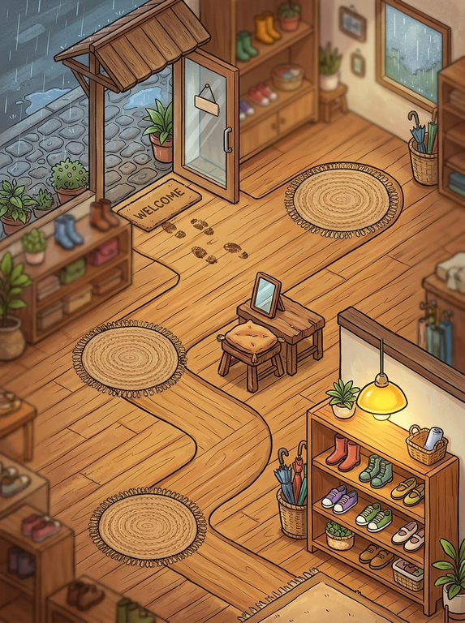

# Tiến độ phát triển — Gọn Tiệm, Sạch Phố ("Ngũ hành giữ tiệm")

Cập nhật: 22/11/2026 • Nhánh: `main` • Trạng thái hiện tại:
- Đã được Claude chấm **`MÀN 1 VUI: ĐẠT`** trong [`docs/REVIEW_LOG.md`](REVIEW_LOG.md).
- **Bước 0 (`docs/ANTIGRAVITY_BRIEF_LAM_DEP.md`):** Đã ghi danh sách tên nhánh nâng cấp và tên màn của chủ đề mới **"Gọn Tiệm, Sạch Phố — Ngũ hành giữ tiệm"** (mục 19, 20, 21) vào [`docs/NAMES.md`](NAMES.md), chờ dòng `NAMES GỌN TIỆM: ĐỒNG Ý`.
- **Bước A (`docs/ANTIGRAVITY_BRIEF_LAM_DEP.md`):** Đã vẽ 3 hình mẫu PNG cùng một nét vào [`docs/art_samples/`](art_samples/), chờ anh Kha & Claude duyệt `NÉT VẼ: ĐỒNG Ý` trong [`docs/REVIEW_LOG.md`](REVIEW_LOG.md).

---

## 1. Bước A — Ba hình mẫu thử nét vẽ (`docs/art_samples/`)

- **Công cụ đã dùng:** Công cụ tạo ảnh tích hợp của Antigravity (`generate_image`), xuất và tối ưu sang định dạng `.png` bằng Pillow (`LANCZOS`, `optimize=True`).
- **Thống nhất phong cách (Nét vẽ):** Hoạt hình vui nhộn, nét viền đậm rõ ràng (`crisp dark outlines`) để nhìn rõ ở kích thước nhỏ trên màn hình điện thoại dọc; đồ vật giữ tiệm và bọn phá đồ có mắt to biểu cảm sinh động; không gian tiệm giày Đà Lạt ngày mưa ấm cúng (sàn gỗ thông mật ong, thảm cói tròn làm ô đặt món, kệ giày gỗ dưới ánh đèn vàng ấm, bên ngoài cửa kính là vỉa hè đá ướt mưa); góc nhìn từ trên xuống hơi chéo (`top-down 3/4`).

| STT | Tệp hình mẫu | Đối tượng | Lời nhắc (Prompt) đã dùng |
|---|---|---|---|
| 1 | [`docs/art_samples/01_dep_tong.png`](art_samples/01_dep_tong.png) | **1 Món giữ tiệm:** Dép Tông cao su (Hành Mộc — khắc Cục Bùn) | `2D mobile game tower asset in a cozy expressive cartoon illustration style: a cute rubber flip-flop sandal (dép tông cao su Việt Nam) with a green and cream rubber sole, bouncy Y-strap with big expressive determined cartoon eyes and a cheerful little grin, viewed from a top-down 3/4 isometric-ish mobile game camera angle, resting on a warm circular wooden display pad with a tiny leaf emblem, crisp dark outlines, vibrant cozy colors, readable at small mobile screen size, original indie game art style, no text, no watermark.` |
| 2 | [`docs/art_samples/02_con_gian.png`](art_samples/02_con_gian.png) | **1 Quái phá đồ:** Con Gián (Hành Mộc — tách 2 gián con khi bị đập) | `2D mobile game enemy sprite in a cozy expressive cartoon illustration style: a round comical cartoon cockroach pest (con gián hoạt hình vui nhộn, không ghê rợn) with a glossy chestnut-brown shell, two wiggly antennae, oversized goofy mischievous cartoon eyes looking sneaky, tiny nimble legs, viewed from a top-down 3/4 mobile game camera angle on a soft warm wooden floor tile, crisp clean outlines, high contrast silhouette so it is clearly readable at small mobile screen size, original indie game art style, no text, no watermark.` |
| 3 | [`docs/art_samples/03_goc_cua_tiem_ngay_mua.png`](art_samples/03_goc_cua_tiem_ngay_mua.png) | **1 Mảnh bản đồ Màn 1:** Vỉa hè ướt mưa dẫn qua cửa tiệm giày tới kệ giày gỗ cuối đường | `2D vertical mobile tower defense game map corner illustration in a cozy expressive cartoon style: a charming Da Lat shoe shop on a rainy day viewed from a top-down slightly angled 3/4 perspective. At the top-left entrance: wet stone sidewalk outside with gentle raindrops and small puddles, glass shop door with a warm welcome doormat where muddy footprints enter; a winding path snakes across warm honey-oak wooden floorboards past circular woven rug tower placement pads and a small shoe-fitting stool; at the bottom-right end of the path stands a tidy warm-lit wooden shoe shelf holding colorful pairs of clean shoes under a glowing warm yellow pendant lamp. Cozy atmosphere, crisp outlines, clear path readability for a mobile portrait screen, original indie game art style, no text, no UI overlay.` |

### Xem nhanh 3 hình mẫu:
- **Dép tông (`01_dep_tong.png`):**
  
- **Con gián (`02_con_gian.png`):**
  
- **Góc cửa tiệm giày ngày mưa (`03_goc_cua_tiem_ngay_mua.png`):**
  

---

## 2. Kết quả cân bằng Màn 1 đã đạt (`MÀN 1 VUI: ĐẠT` — giữ nguyên luật và số liệu cân bằng)

| Cách chơi (trong `docs/review/2026-11-22_sim_man1.ts`) | Kết quả |
|---|---|
| **Bot phối hợp đúng hệ (`bot`)** | **Thắng, 11/20 mạng (2 sao)** |
| **Lấp 9 ô toàn 1 loại quân (`all` & `all-noupg`)** | **Thua cả 10/10 lần (0/20 mạng)** |
| **60 lần đặt loại quân ngẫu nhiên (`random-mix 60`)** | **Thắng 10/60 (16.7%), Thua 50/60** *(chỉ 1/60 lần 3 sao)* |
| **Đặt xoay vòng 5 loại theo thứ tự ô (`cycle-5-types`)** | **Thắng sát nút, 2/20 mạng (1 sao)** |
| **Giới hạn 1–4 quân 1 loại (`limit 1..4`, Mộc / Hỏa)** | **Thua cả 8/8 trường hợp (0/20 mạng)** |

---

## 3. Lệnh kiểm tra nhanh

```bash
npm test          # 16/16 unit test
npm run build     # Đóng gói web tĩnh vào dist/
npm run test:e2e  # 2/2 kịch bản Playwright điện thoại dọc 390x844
```
