VIỆC 9 PHỐ THẬT XONG
VIỆC 8 TRÙM PHỐ XONG
VIỆC 7 CHUỖI TƯƠNG SINH XONG
VIỆC 6 GỌN TRANG BỊ XONG
CHẶNG 3 CHUẨN BỊ XONG
TRANG BỊ VẼ XONG
MÀN 1 VẼ LẠI XONG
MÀN 3 VẼ XONG
MÀN 2 VẼ XONG
LÀM ĐẸP XONG

# Tiến độ phát triển — Gọn Tiệm, Sạch Phố ("Ngũ hành giữ tiệm")

Cập nhật: 23/11/2026 • Nhánh: `main` • Trạng thái hiện tại: **Đã hoàn thành trọn vẹn Việc 6 (Gọn chữ bảng trang bị), Việc 7 (Chuỗi tương sinh & Ngũ hành viên mãn trên sân), Việc 8 (Trận trùm phố Dốc Đà Lạt + Bão Lốc 5 màu + bảng chọn 6/15 món + huy hiệu vàng *Giữ trọn phố*) và Việc 9 (2 Phố thật Đà Lạt: Tăng Bạt Hổ – Trương Công Định & Phố Cà Phê, bản đồ ghi nguồn OSM, 18 món × 4 bậc + 14 quái vẽ riêng vào `streets_atlas.webp`, xoá hình tạm trong `atlasIcons.ts`, thêm 2 ghim trên Bản đồ Đà Lạt). Không sửa bất kỳ tệp nào trong `src/core/`.**

---

## 0E. Việc 6, 7, 8 & 9 — Bảng trang bị gọn, Chuỗi tương sinh, Trận Trùm Phố & 2 Phố Thật Đà Lạt — Đã hoàn thành (Antigravity)

1. **Việc 6 — Gọn chữ bảng trang bị (`src/scenes/TitleScene.ts`, `src/ui/styles.css`):**
   - Dùng trực tiếp các hàm có sẵn trong `src/core/equipment.ts` (`statShort`, `bonusChips`, `previewEquip`).
   - Dòng giải thích thu gọn thành 1 dòng `"Món chống lưng đúng hành sẽ sáng dòng ẩn ●"` kèm nút `?` mở bảng luật đầy đủ.
   - 10 ô vòng quanh chủ tiệm chỉ hiển thị hình món + chấm sáng `●○` (bỏ chữ tên ô dưới chân ô).
   - Danh sách chọn món hiện 1 dòng so sánh từ `previewEquip` (xanh khi mạnh hơn, đỏ khi yếu hơn, kèm huy hiệu `"✦ Viên mãn!"`), chỉ số rút gọn bằng `statShort` (bấm giữ hoặc chạm 2 lần mở `statText` đầy đủ).
   - Bộ đồ mặc định gấp gọn chỉ hiện bộ đang mặc dở, nút `"Đủ 4 bộ ▾"` mở đủ 4 bộ; tổng sức mạnh dùng hàng chip gọn từ `bonusChips`, chạm từng chip xem câu đầy đủ.
2. **Việc 7 — Hiện chuỗi tương sinh trên sân (`src/scenes/TdStageScene.ts`, `src/game/synergyText.ts`, `src/ui/styles.css`):**
   - Tia nối tương sinh dày và rực dần theo `tower.synergyChainLength` (2 → 3 → 4..5), gắn nhãn nhỏ sắc nét `"Chuỗi 3 +25%"` / `"Chuỗi 4 +40%"` / `"Chuỗi 5 +40%"`.
   - Khi `engine.fullCycleActive` bật: hiện banner cầu vồng `"✦ Ngũ hành viên mãn! Mọi món nhanh +20% ✦"` cùng vòng sáng 5 màu quay quanh các món trong chuỗi 5 hành.
   - Bảng nâng cấp món hiển thị thêm dòng `"✦ Chuỗi tương sinh: X món (+25% / +40% sức)"`.
3. **Việc 8 — Vẽ Trận trùm phố "Dốc Đà Lạt" (`stage_4`) (`public/assets/map_trum_pho.webp`, `public/assets/streets_atlas.webp`, `src/game/shopStreetArt.ts`, `src/scenes/TitleScene.ts`, `src/scenes/TdStageScene.ts`):**
   - Nền vector `public/assets/map_trum_pho.webp` (`720×1040`, 51.6 KB) vẽ con dốc 3 tầng đi qua Tiệm Giày → Tiệm Bánh → Tiệm Hoa → Quầy cuối phố dưới trời giông tối, kèm mưa bão xiên và lá cây cuốn trong gió.
   - Trùm **Bão Lốc Cuối Mùa** (`st_bao_loc`) vẽ đủ 5 màu theo 5 hành (`thuy`, `moc`, `hoa`, `tho`, `kim`), đổi hình + banner `"Đổi hành!"` và hiệu ứng `"Gọi quân!"` khi gọi lính.
   - Bảng chọn bộ 6/15 món trước khi vào trận có gợi ý `"Đủ 5 hành + 1 hỗ trợ"` và lưu qua `saveStreetLoadout`.
   - Mặt tiền **Trùm Phố** trên Con phố dốc (khóa cho tới khi qua 3 tiệm), thắng nhận huy hiệu vàng **"Giữ trọn phố"** (`icon_badge_giu_tron_pho`) & nhấn mạnh quà rơi **Hàng hiệu ★** chắc chắn; bảng kết quả hiện `"PHỐ SẠCH BÓNG!"` / `"PHỐ BỊ BÃO CUỐN"`.
4. **Việc 9 — Vẽ 2 Phố thật Đà Lạt (`street_tang_bat_ho` & `street_pho_ca_phe`) (`scripts/build_street_maps.py`, `scripts/build_streets_atlas.py`, `src/game/atlasIcons.ts`, `src/scenes/BootScene.ts`, `src/scenes/TitleScene.ts`, `src/scenes/TdStageScene.ts`):**
   - 2 nền vector khớp 100% `stage.paths` & `stage.pads`, ghi rõ `"© OpenStreetMap contributors"` ở góc dưới:
     - `public/assets/map_street_tang_bat_ho.webp` (55.8 KB): dốc đêm gần chợ, quán ăn đêm, hostel có xe máy đậu, bar dưới hầm.
     - `public/assets/map_street_pho_ca_phe.webp` (77.5 KB): quán cà phê xưa, sân thượng dù gỗ đèn dây, nhiều cây thông xanh.
   - Atlas riêng `public/assets/streets_atlas.webp` (`1536×1600`, 699.7 KB, ≤ 2048×2048 GPU di động) + `streets_atlas.json` (**294 khung hình**): 18 món × 4 bậc (`t1`, `t2`, `t3a`, `t3b`) × 3 khung đánh + 14 quái (12 quái chính + 2 quái con) × 4 khung đi + Trùm `st_bao_loc` 5 hành × 4 khung đi + 2 biểu tượng (`icon_street_life`, `icon_badge_giu_tron_pho`).
   - Đã **xoá sạch phần hình tạm** `ROLE_FALLBACK_TOWER` và `TRAIT_FALLBACK_ENEMY` trong `src/game/atlasIcons.ts`.
   - Thêm khu **Bản đồ Đà Lạt** trên màn hình chính đọc từ `REAL_STREET_STAGES` với 2 điểm ghim chọn phố thật, khóa tới khi thắng Trận trùm phố; hỗ trợ mở thử trực tiếp `/#street_tang_bat_ho` và `/#street_pho_ca_phe` (kể cả đổi hash trực tiếp trên thanh địa chỉ).
- **Kiểm chứng:** `npm test` **59/59** qua, `npm run build` qua, `npm run test:e2e` **16/16** qua (0 lỗi console, 0 gọi mạng ngoài), tổng `dist/` = **4.4 MB** (≤ 5 MB), **`git diff src/core/` hoàn toàn trống**.

| Hạng mục Việc 6–9 (`390×844`) | Ảnh kiểm chứng |
|---|---|
| Việc 6 — Bảng trang bị gọn chữ + `statShort` chạm 2 lần mở `statText` | 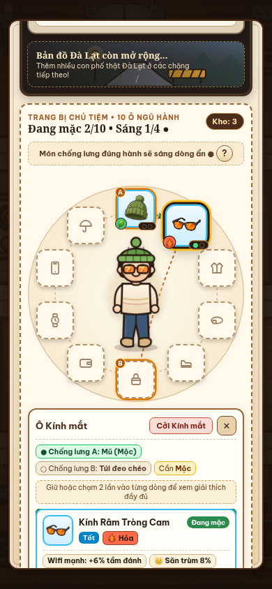 |
| Việc 7 — Chuỗi 5 món (+40%) + Ngũ hành viên mãn trên sân | 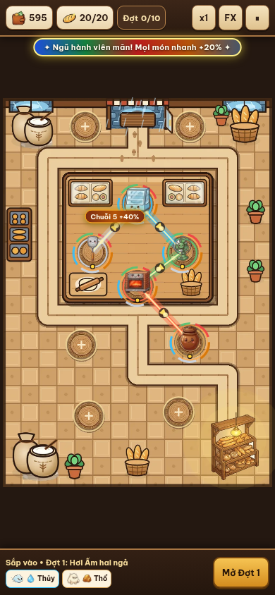 |
| Việc 7 — Dòng chuỗi tương sinh trong bảng nâng cấp | 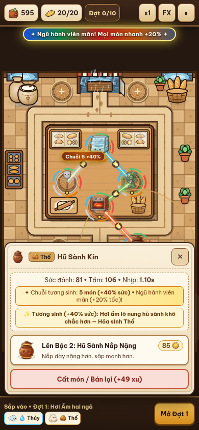 |
| Việc 8 — Bảng chọn 6/15 món ra phố (`Đủ 5 hành + 1 hỗ trợ`) | 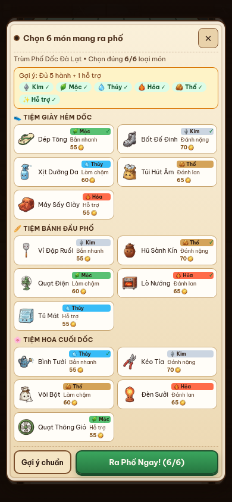 |
| Việc 8 — Trận Trùm Phố Dốc Đà Lạt & Bão Lốc đổi hành | 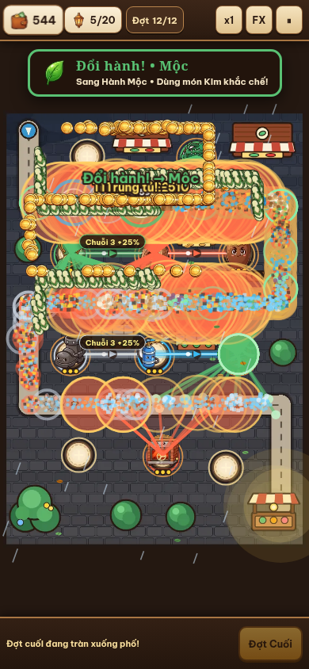 |
| Việc 8 — Thắng Trùm Phố: `PHỐ SẠCH BÓNG!`, huy hiệu vàng & Hàng hiệu ★ | 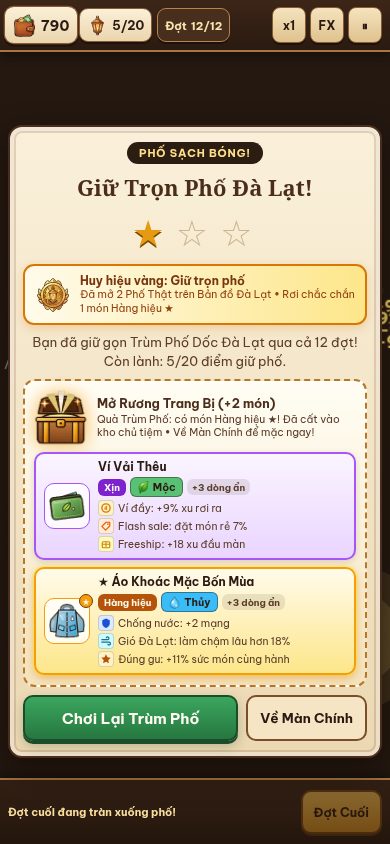 |
| Việc 9 — Bản đồ Đà Lạt mở 2 Phố Thật sau khi thắng Trùm Phố | 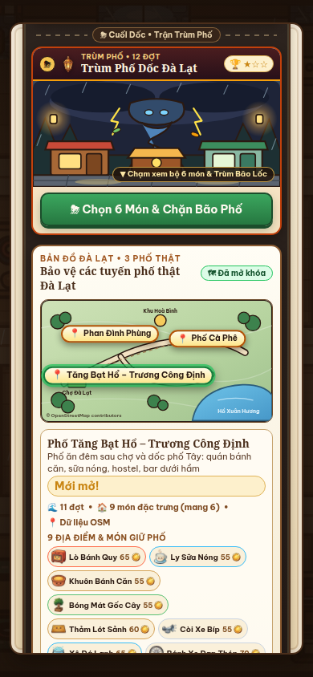 |
| Việc 9 — `/#street_tang_bat_ho`: bảng đặt món riêng & giao tranh | 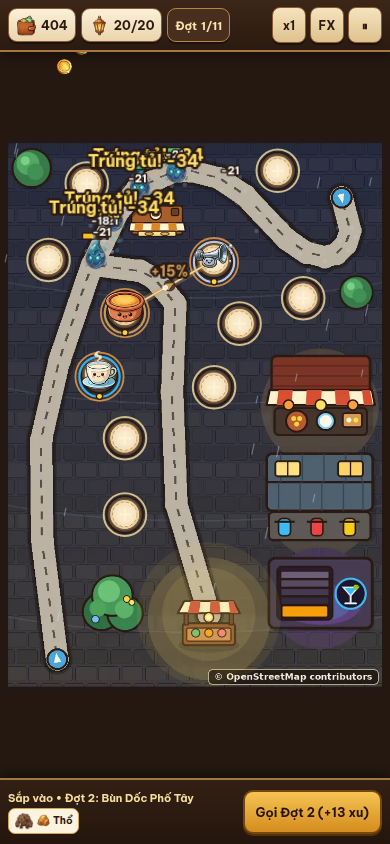 |
| Việc 9 — `/#street_pho_ca_phe`: nền cà phê sân thượng & giao tranh | 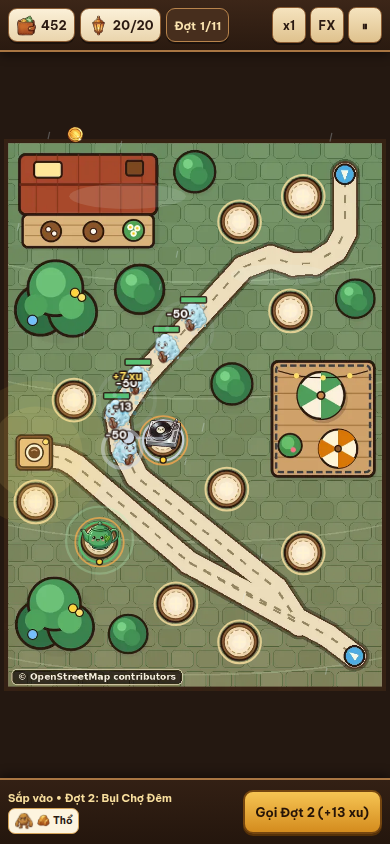 |

---

## 0D. Chuẩn bị cho người lạ chơi (Chặng 3 — 5 việc) — Đã hoàn thành (Antigravity)

1. **Màn chọn màn "Con phố dốc" (`src/scenes/TitleScene.ts`, `src/game/shopStreetArt.ts`, `src/ui/styles.css`):**
   - Đọc động từ `SHOP_STREET`, `isShopUnlocked`, `shopStars`, `getShopStage` trong `src/core/shopStreet.ts` (không đổi số liệu `src/core/`).
   - Thay 3 ô chữ bằng **con phố dốc Đà Lạt mùa mưa** với 3 mặt tiền vẽ riêng (**Tiệm Giày Hẻm Dốc → Tiệm Bánh Đầu Phố → Tiệm Hoa Cuối Dốc**), ánh đèn vàng ấm, biển hiệu gắn số sao, cửa cuốn kéo xuống + ổ khóa đồng + dòng *"Qua tiệm trước để mở"* cho tiệm chưa mở, và góc *"Con dốc còn dài..."* chừa sẵn mặt bằng nối dài phố.
   - Chạm bất kỳ tiệm nào hiện thẻ thông tin đầy đủ (tên, số đợt, 5 món của chính tiệm đó từ `getStageTowerList`, các quái chính, nút `Mở Cửa ...` giữ nguyên `btn-start-stage-1/2/3`), đồng thời đồng bộ **Bảng giới thiệu 5 món** phía dưới theo tiệm đang chọn.
2. **Hướng dẫn chơi lần đầu (`src/game/tutorialOverlay.ts`, `src/scenes/TdStageScene.ts`, `src/ui/styles.css`):**
   - Gắn trực tiếp `TutorialController` (`src/core/tutorial.ts`) và `shouldShowTutorial()` / `markTutorialDone()` (`src/core/saveSystem.ts`) — không viết lại luật bước.
   - Hiện avatar **Chủ tiệm Đà Lạt** (dùng lại `renderShopkeeperAvatarSvg` mặc đúng đồ đang đeo), bong bóng lời, tiến độ 5 bước, mũi tên vàng nảy chỉ đúng từng mục tiêu (`pad:pad_1`, `build:wood_tower`, `testid:td-upcoming-box`, sơ đồ vòng Ngũ Hành `element_guide`, `testid:btn-call-wave`), nút **Tiếp** / **Bỏ qua** ở mọi bước, tạm dừng theo `tutorial.shouldPause()`.
   - Thêm **Menu Tạm dừng (`⏸`)** có nút **"Xem lại hướng dẫn"** (`btn-replay-tutorial`) và e2e xác nhận người mới vào Màn 1 thấy hướng dẫn, bấm Bỏ qua không hiện lại, bấm Xem lại trong `⏸` hiện lại đủ.
3. **Biểu tượng app + Màn hình chờ (`src/game/brandLogo.ts`, `scripts/build_icons.mjs`, `public/icons/`, `index.html`, `src/scenes/BootScene.ts`):**
   - Logo vuông **"Gọn Tiệm, Sạch Phố"** (mái hiên sọc đỏ-kem Đà Lạt, đèn vàng, chiếc Dép Tông hoạt hình, 5 hạt Ngũ Hành, biển gỗ chữ Việt rõ nét).
   - Đủ 4 biểu tượng app trong `public/icons/`: `icon-512.png` (512×512), `icon-192.png` (192×192), `apple-touch-icon-180.png` (180×180), `favicon-32.png` (32×32) khai báo đầy đủ trong `index.html`.
   - **Màn hình chờ (`BootScene`):** nền hộp giày giấy kraft ấm, logo vuông, dòng phụ **"Ngũ hành giữ tiệm"** và thanh tải chạy theo đúng tiến độ `this.load.on('progress')`.
4. **Nhạc nền nhẹ tự tạo bằng Web Audio (`src/game/music.ts`, `src/game/sound.ts`, `src/game/preferences.ts`, `CREDITS.md`):**
   - 5 giai điệu ngũ cung ngắn tự tổng hợp bằng Web Audio API (không tệp nhạc ngoài): **Màn hình đầu** (*Phố Dốc Chiều Mưa*), **Tiệm Giày** (*ấm áp*), **Tiệm Bánh** (*vui tươi*), **Tiệm Hoa** (*trong trẻo*) và **Trận Trùm Mùa Nồm** (*nhịp dồn hơn*, tự chuyển khi Trùm xuất hiện).
   - Âm lượng nhẹ hơn tiếng hiệu ứng SFX, chỉ khởi chạy sau lần chạm đầu tiên, nút tắt **Nhạc** (`btn-toggle-music`) riêng với nút tắt **Tiếng** (`btn-toggle-sfx`) ở cả màn hình chính & menu `⏸`, nhớ trên máy qua `localStorage`, đã ghi rõ tự tạo trong `CREDITS.md`.
5. **Ảnh cho kênh Gọn & khi chia sẻ link (`scripts/build_marketing_assets.mjs`, `docs/marketing/`, `public/og-image.png`, `index.html`):**
   - **3 ảnh bìa video dọc 1080×1920** chữ Việt to kèm logo: [`cover_01_dat_sai_mon.png`](marketing/cover_01_dat_sai_mon.png) (*"Đặt sai món là thua ngay!"*), [`cover_02_trung_tu.png`](marketing/cover_02_trung_tu.png) (*"Trúng tủ! ×1.75 — Quét sạch phố!"*), [`cover_03_trum_doi_hanh.png`](marketing/cover_03_trum_doi_hanh.png) (*"Trùm Mùa Nồm đổi 3 hành!"*).
   - **1 ảnh chia sẻ link 1200×630** ([`public/og-image.png`](../public/og-image.png), nén gọn 147 KB) + khai báo đầy đủ `og:title`, `og:description`, `og:image`, `twitter:card` trong `index.html`.
   - **1 logo vuông 1080×1080** ([`docs/marketing/logo_vuong_1080.png`](marketing/logo_vuong_1080.png)) cho ảnh đại diện / bài đăng.

| Hạng mục Chặng 3 (`390×844`) | Ảnh kiểm chứng |
|---|---|
| 1. Con phố dốc — đầu phố & Tiệm Giày |  |
| 1. Chạm Tiệm Bánh xem 5 món & bầy quái | 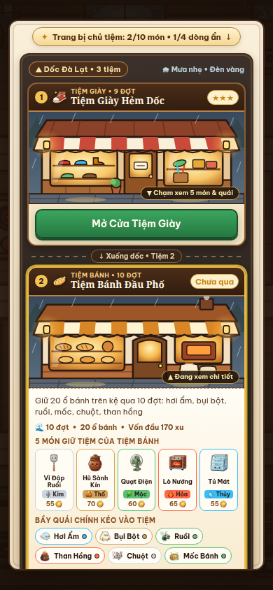 |
| 1. Tiệm Hoa đang kéo cửa cuốn khóa | 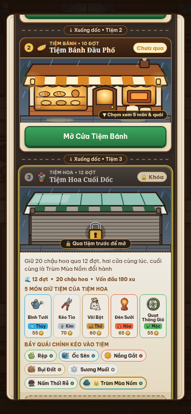 |
| 2. Hướng dẫn Bước 1/5 — Avatar chủ tiệm & mũi tên ô trống | 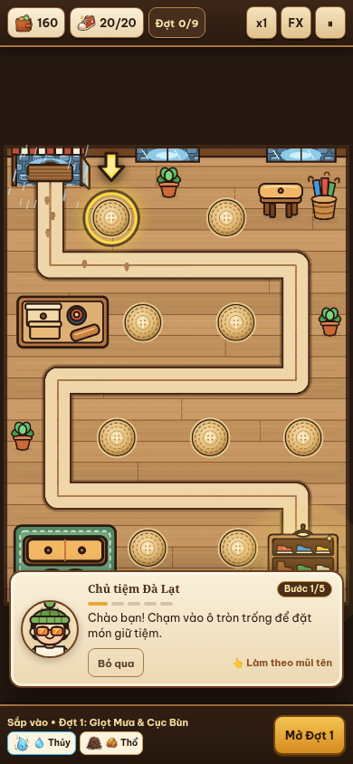 |
| 2. Hướng dẫn Bước 2/5 — Chỉ vào thẻ Dép Tông | 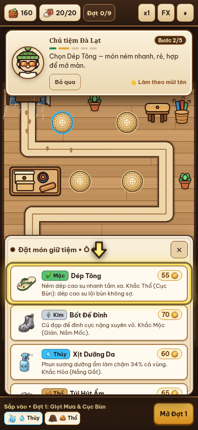 |
| 2. Hướng dẫn Bước 4/5 — Sơ đồ Vòng Ngũ Hành | 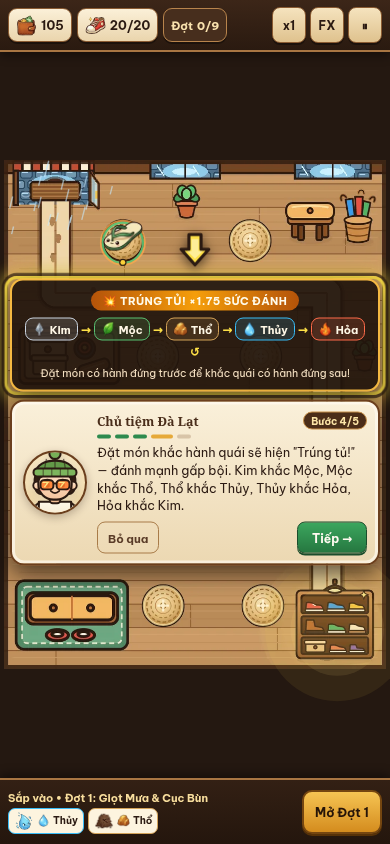 |
| 3. Màn hình chờ hộp giày (`BootScene`) & Logo | 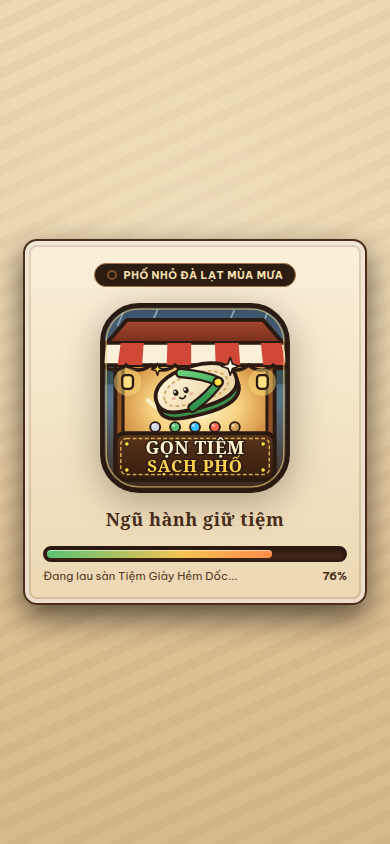 |
| 4. Menu tạm dừng `⏸` với nút tắt Nhạc / Tiếng riêng & Xem lại hướng dẫn | 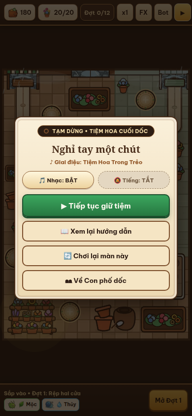 |

---

## 0C. Vẽ Trang bị chủ tiệm (10 món, 50 biểu tượng, vòng ngũ hành v2) & Làm đẹp Tuyệt chiêu Bậc 4 — Đã hoàn thành (Antigravity)

- **Atlas riêng `public/assets/gear_atlas.webp` (`768×720`, 103 KB) + `gear_atlas.json` (19 KB) — 56 khung nền trong suốt (`scripts/build_gear_atlas.py`, KHÔNG chạm `gon_tiem_atlas.webp`):**
  - **50 biểu tượng trang bị** (10 loại: Mũ, Kính mắt, Áo khoác, Dây nịt da, Giày, Túi đeo chéo, Ví da, Đồng hồ, Điện thoại, Ô dù × 5 hành Kim/Mộc/Thủy/Hỏa/Thổ) vẽ khớp từng mẫu trong `GEAR_NAMES` (`src/core/equipment.ts`), tách nền trong suốt sạch cả lỗ quai túi & gọng kính.
  - **2 hình rương quà** đóng/mở (`gear_chest_closed`, `gear_chest_open`) cho hiệu ứng mở rương khi thắng màn.
  - **4 huy hiệu bộ đồ** (`set_di_mua`, `set_phuot`, `set_van_phong`, `set_chu_tiem_xin`).
- **Hình Chủ tiệm Đà Lạt mặc đúng đồ đang đeo (`src/game/shopkeeperAvatar.ts`):**
  - Người Đà Lạt trẻ, thân thiện đứng giữa vòng trang bị, tự động đổi đúng hình & màu hành của từng món đang đeo: **Mũ, Kính mắt, Áo khoác, Dây nịt da, Giày, Túi đeo chéo, Ô dù, Đồng hồ**; có hào quang vàng khi đạt **Ngũ hành viên mãn** hoặc mặc đồ **Hàng hiệu**.
- **Bảng trang bị 10 ô xếp vòng tròn (`src/scenes/TitleScene.ts`, `src/game/gearUiHelpers.ts`, `src/ui/styles.css`):**
  - Giữ đủ `data-testid="td-gear-box"` và `gear-slot-*` cho cả 10 ô.
  - Viền & thẻ màu theo **4 hạng v2**: Thường (xám) / Tốt (xanh) / Xịn (tím) / Hàng hiệu (vàng kim có vương miện ★, tên riêng `LEGEND_NAMES`).
  - Vẽ đủ **2 đường nối chống lưng** (`supporterSlots`: vòng ngoài ô liền trước A + dây sao trong ô cách 6 bước B), sáng theo màu hành món chống lưng kèm mũi tên khi sinh ra hành ô này; chấm sáng dòng ẩn (`●` / `○`, dòng 3 `✦` khi **Ngũ hành viên mãn** kèm dải hiệu ứng vinh danh).
  - Bảng **4 Bộ đồ** (Đi Mưa, Phượt Đà Lạt, Dân Văn Phòng, Chủ Tiệm Xịn) hiện huy hiệu, đếm số món (`x/3`, `x/4`) và dòng thưởng sáng/tối.
  - **19 biểu tượng nhỏ riêng** cho 19 dòng vui trong `STAT_NAME` (Đúng gu, Tự tin, Wifi mạnh, Cà phê sữa đá, Freeship, Chống nước, Ví đầy, Pin trâu, Sạc nhanh, Mã giảm giá, Flash sale, Bảo hành 12 tháng, Bắt trend, Combo, Gió Đà Lạt, Đi mưa không ướt, Xịt côn trùng, Khách quen, Săn trùm).
- **Bảng kết quả thắng màn (`td-result-drops`):**
  - Rương quà rung nhẹ rồi bật mở rực sáng (kèm âm thanh mở rương Web Audio `playChestOpen`, tôn trọng `reduceMotion`), lần lượt bung các **thẻ đồ rơi** có hình món, viền & nhãn hạng, biểu tượng hành và các dòng hiện.
- **Làm đẹp Tuyệt chiêu Bậc 4 (`src/scenes/TdStageScene.ts`, `src/game/sound.ts`, bỏ phần nâng cấp bằng sao):**
  - Giữ `data-testid="btn-unlock-ultimate"` và `btn-use-ultimate` trong bảng nâng cấp với thẻ vàng Bậc 4 (huy hiệu `IV`, `+20% sức đánh vĩnh viễn`, thanh hồi chiêu trực tiếp).
  - **Viền hào quang vàng + 4 hạt sáng xoay + 4 chấm bậc** trên món đã lên Bậc 4 (`tower.hasUltimate`), cùng vòng cung hồi chiêu trên chân món.
  - **Nút tuyệt chiêu nổi ngay trên món (`★ CHIÊU`)** khi sẵn sàng (`engine.canActivateUltimate(padId)`), bấm kích hoạt trực tiếp và chuyển thành **vòng đếm hồi chiêu tròn 30s** (`ultimateCooldownRemaining`).
  - **5 hiệu ứng & âm thanh riêng cho sự kiện `ultimate` theo vai** (`single_far` bắn nhanh tia chớp, `heavy_slow` sóng địa chấn kép + sét + rung, `slow_aura` vòm khóa xoáy, `aoe_splash` quả cầu nổ + mưa tàn lửa, `support_buff` sóng cộng hưởng + tia sáng nối tới từng đồng đội quanh nó) kèm banner tên tuyệt chiêu `ULTIMATE_NAMES`.
- **Kiểm chứng:** `npm test` **37/37** qua, `npm run test:e2e` **8/8** qua (0 lỗi console, 0 gọi mạng ngoài), tổng `dist/` = **3.0 MB** (≤ 5 MB), **không sửa bất kỳ tệp nào trong `src/core/`**.

| Cảnh Trang bị & Bậc 4 (`390×844`) | Ảnh kiểm chứng |
|---|---|
| Vòng 10 ô & Chủ tiệm mặc đồ khởi đầu (Mũ Mộc → Kính Hỏa) | 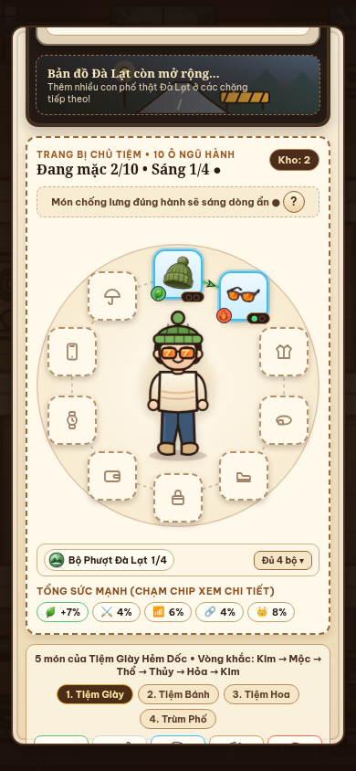 |
| Chạm ô mở ngăn chọn đồ & hiện rõ 2 chống lưng A/B | 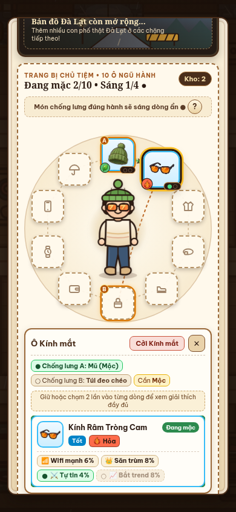 |
| Đủ 10 món Ngũ hành viên mãn & chủ tiệm mặc đủ đồ | 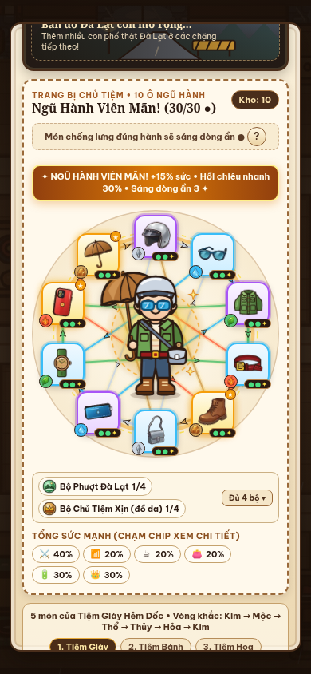 |
| Thắng màn mở rương rơi thẻ đồ theo hạng & hành |  |
| Bảng nâng cấp Bậc 4 (`btn-unlock-ultimate`) | 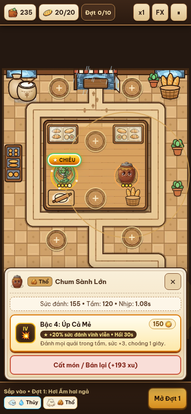 |
| Hào quang Bậc 4 & nút tuyệt chiêu `★ CHIÊU` nổi trên món | 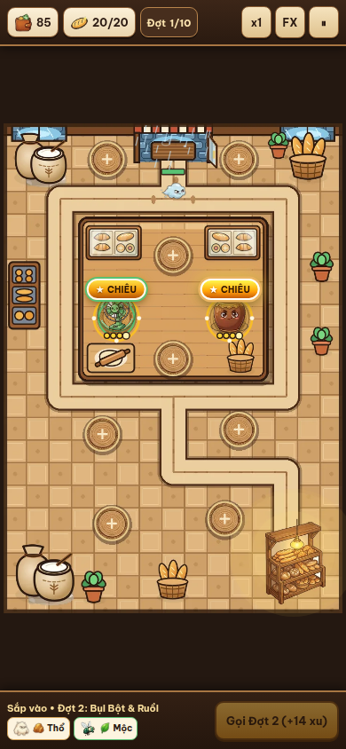 |
| Tung tuyệt chiêu `Úp Cả Mẻ` + hiệu ứng vùng + vòng hồi chiêu 30s | 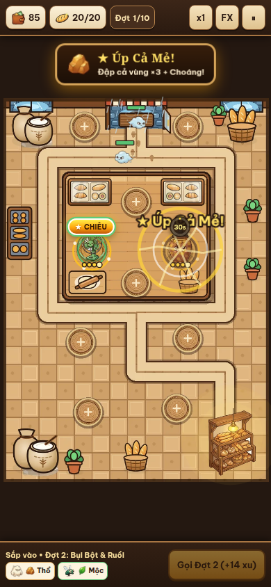 |

---

## 0B. Vẽ lại Màn 1 "Tiệm Giày Hẻm Dốc" theo cách Màn 2 — Đã hoàn thành (Antigravity)

- **Nền bản đồ vector vẽ mới hoàn toàn `public/assets/map_man1_tiem_giay.webp` (`720×960` = 2× khung logic `360×480`, 47 KB — `scripts/build_stage1_v2_map.py`):**
  - Vẽ mới 100% dạng vector SVG (render qua `scripts/render_svgs.mjs` + ghép Pillow alpha-composite chuẩn), không còn cắt ghép từ ảnh mẫu cũ.
  - Khớp 100% đường chữ S qua 2 khúc cua chữ U và đúng vị trí **9 thảm cói tròn** trong `STAGE_1_DEFINITION`.
  - Sàn gỗ thông ấm, cửa kính mưa đầu đường `(48, 24)` với mái hiên sọc đỏ-kem & thảm sọc nâu sạch (không chữ nước ngoài), 2 cửa sổ mưa trên tường, ghế thử giày bọc đệm, giỏ ô dù, bàn hộp giày & hộp xi, ghế dài trên thảm xanh góc dưới trái, và **kệ giày gỗ 3 tầng đèn vàng ấm** ở cuối đường `(304, 455)`.
- **5 món × 4 bậc vẽ RIÊNG TỪNG HÌNH (20 hình gốc khác biệt rõ ràng, không dùng overlay PIL chồng từ 1 ảnh) × 3 khung đánh (60 khung, giữ nguyên 100% tên khung trong atlas):**
  - `wood_tower`: *Dép Tông* → *Dép Tông Đế Dày* → *Dép Tông Kép* (3A, hai dép bắt chéo) / *Dép Tông Gai Bám* (3B, dép đinh gai bùn).
  - `metal_tower`: *Bốt Đế Đinh* → *Bốt Đinh Thép* → *Bốt Chốt Chì* (3A, bốt thép bọc chốt chì nặng) / *Bốt Đinh Quét Dọc* (3B, bốt hàng gai bạc quét dọc).
  - `water_tower`: *Xịt Dưỡng Da* → *Bình Xịt Áp Lực* → *Xịt Bọt Tuyết Lạnh* (3A, bình phủ bọt tuyết & bông băng) / *Xịt Vòi Xoáy* (3B, vòi đôi phun xoáy nước).
  - `fire_tower`: *Túi Hút Ẩm* → *Giỏ Hút Ẩm Cỡ Đại* → *Thảm Hạt Hút Khô* (3A, thảm dệt phủ hạt hút ẩm) / *Chùm Túi Nổ Liên Hoàn* (3B, chùm 3 túi nổ hạt).
  - `earth_tower`: *Máy Sấy Giày* → *Máy Sấy Hai Vòi* → *Máy Sấy Khử Khuẩn* (3A, vòm sấy vàng lấp lánh) / *Máy Sấy Gió Nhiệt Cao* (3B, động cơ thổi luồng nhiệt đỏ cam).
- **7 quái Màn 1 vẽ lại riêng từng con × 4 khung đi (giữ nguyên tên khung):** *Giọt Mưa* (`fast_metal`), *Cục Bùn* (`tank_earth`), *Gián* (`split_fire` — dáng gián thân dẹt 2 râu dài), *Gián Con* (`split_fire_mini`), *Nấm Mốc* (`healer_wood`), **Chuột** (`disrupt_water` — vẽ kỹ, dùng chung Màn 2), **Nắng Gắt** (`fly_wood` — vẽ kỹ, dùng chung Màn 3) + đồng bộ lại `boss_water`.
- **Toàn bộ biểu tượng vẽ lại cùng nét hoạt hình (xoá sạch toàn bộ hình vẽ khối PIL):** 5 hành (`el_kim`, `el_moc`, `el_thuy`, `el_hoa`, `el_tho`), xu (`icon_coin`), ví (`icon_wallet`), đôi giày (`icon_shoe_life`), đạn dép tông (`proj_dep_tong`), đạn gói hút ẩm (`proj_silica`), thảm cói (`prop_pad_rug`) và kệ giày gỗ (`prop_shoe_shelf`).
- **Kiểm chứng:** `npm test` **35/35** qua, `npm run test:e2e` **6/6** qua (0 lỗi console, 0 gọi mạng ngoài), tổng `dist/` = **2.8 MB** (≤ 5 MB), **giữ nguyên toàn bộ 288 tên khung atlas** (Màn 2 và Màn 3 nguyên vẹn 100%), **không sửa bất kỳ tệp nào trong `src/core/`**.

| Cảnh Màn 1 (`390×844`) | Trước khi vẽ lại (`man1v2_*_truoc_*.png`) | Sau khi vẽ lại (`man1v2_*_sau_*.png`) |
|---|---|---|
| **1. Màn hình chính & Biểu tượng** | 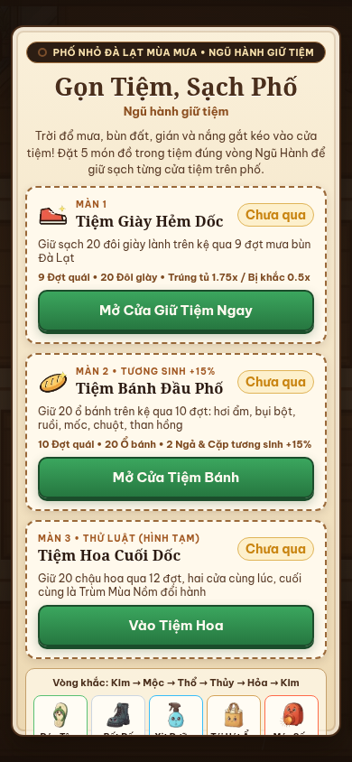 | 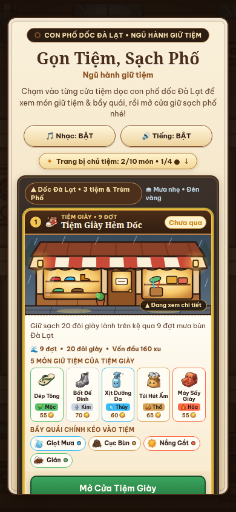 |
| **2. Nền vector & Bảng đặt 5 món** |  | 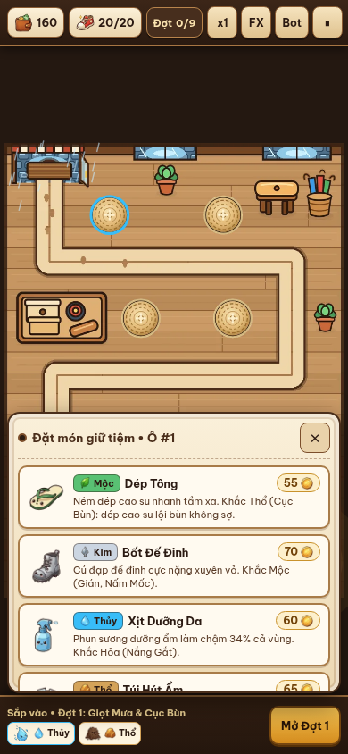 |
| **3. Giao tranh đường chữ S** |  | 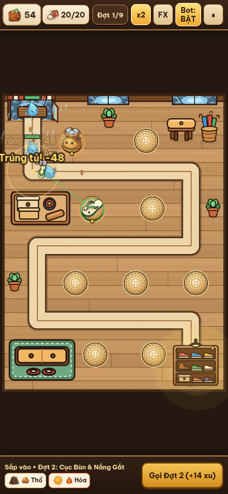 |
| **4. Thắng màn & Tháp Bậc 2–3 mới** |  |  |

---

## 0A. Màn 3 "Tiệm Hoa Cuối Dốc" — Đã hoàn thành (Antigravity)

- **Nền bản đồ `public/assets/map_man3_tiem_hoa.webp` (`720×1040` = 2× khung logic `360×520`, 75 KB):** Vẽ vector SVG + ghép Pillow khớp 100% `STAGE_3_DEFINITION` trong `src/core/shops/flower.ts`:
  - **2 cửa vào độc lập:** Cửa chính tiệm hoa trên trái (`x=40, y=24`, mái hiên sọc xanh-kem, thảm chùi chân sạch không chữ nước ngoài) và Cửa hông nhà kính trên phải (`x=330, y=24`, mái kính khung xanh-trắng, sương sớm Đà Lạt).
  - **2 lối đi sỏi kem** vòng qua luống hoa cẩm tú cầu, chậu đất nung, kệ nhà kính rồi **hợp lại** tại `(180, 330) → (180, 420) → (70, 420) → (70, 470)` dẫn tới **giàn hoa trưng bày** 3 tầng dưới ánh đèn vàng ấm, cùng **11 ô đặt món** rõ nét.
- **Đủ bộ Sprite nền trong suốt vào Atlas (`public/assets/gon_tiem_atlas.webp`, `1536×1712`, 288 khung hình, 713 KB):**
  - **5 món Tiệm Hoa × 4 bậc vẽ RIÊNG TỪNG HÌNH (`t1`, `t2`, `t3a`, `t3b` — 20 hình riêng biệt) × 3 khung đánh (60 khung):**
    - `fl_can` (**Thủy**): *Bình Tưới* → *Bình Tưới Vòi Sen* → *Vòi Xịt Tăng Áp* / *Bình Phun Sương Dưỡng*.
    - `fl_shears` (**Kim**): *Kéo Tỉa* → *Kéo Tỉa Cán Dài* → *Kéo Cắt Cành Lớn* / *Kéo Xén Hàng Rào*.
    - `fl_lime` (**Thổ**): *Vôi Bột* → *Vôi Bột Rắc Dày* → *Vòng Vôi Khép Kín* / *Vôi Trộn Tro Bếp*.
    - `fl_heater` (**Hỏa**): *Đèn Sưởi* → *Đèn Sưởi Hai Bóng* → *Lò Sưởi Than* / *Đèn Hồng Ngoại Nhà Kính*.
    - `fl_vent` (**Mộc**): *Quạt Thông Gió* → *Quạt Thông Gió Hai Cánh* → *Quạt Nhà Kính* / *Quạt Hút Thông Thoáng*.
  - **6 quái mới × 4 khung đi (24 khung) + dùng lại Nắng Gắt (`fly_wood`):** *Rệp* (`fl_aphid`), *Ốc Sên* (`fl_snail`, kèm vệt nhớt lấp lánh), *Bụi Đất* (`fl_dust`), *Bụi Nhỏ* (`fl_dust_mini`), *Sương Muối* (`fl_frost`), *Nấm Thối Rễ* (`fl_rot`).
  - **Trùm Mùa Nồm (`fl_monsoon`) — 3 màu riêng theo hành × 4 khung đi (12 khung):**
    - Hành **Thủy** (`enemy_fl_monsoon_f0..f3`): đám mây bão xanh dương đậm có vương miện & giọt mưa.
    - Hành **Mộc** (`enemy_fl_monsoon_moc_f0..f3`): đổi sang xanh rêu dây leo & vương miện lá.
    - Hành **Kim** (`enemy_fl_monsoon_kim_f0..f3`): đổi sang bạc thép gai băng sắc lạnh.
  - **Biểu tượng & đạo cụ:** Chậu hoa Đà Lạt (`icon_flower_life` cho HUD mạng & màn chính), giàn hoa trưng bày (`prop_flower_rack`).
  - **Đã xoá sạch toàn bộ bảng hình tạm `PLACEHOLDER_FRAME_ALIAS` khỏi `src/game/atlasIcons.ts`** (cả 3 màn đều dùng 100% hình vẽ thật).
- **Hiệu ứng & giao diện Màn 3:**
  - **Sự kiện `element_shift` (Trùm đổi hành):** đổi hình & hoạt ảnh Trùm sang màu hành mới (`thuy` → `moc` → `kim`), vòng sáng bùng nổ, chữ lớn **"Đổi hành!"** trên đầu Trùm + banner lớn kèm biểu tượng hành mới & gợi ý khắc chế, âm thanh riêng (`playBossShift`), rung nhẹ màn hình (tôn trọng `reduceMotion`).
  - **Khoá ô Màn 3 trên `TitleScene`:** khoá tới khi qua Màn 2 (`unlockedStage >= 3`), nhưng `?stage=3` hoặc `?bot=1` vẫn mở thử ngay; hỗ trợ thêm `?video=1` ẩn nút Bot & tự bật x2 khi quay video.
  - **5 kiểu đòn đánh & hiệu ứng chết riêng** cho toàn bộ món và quái Tiệm Hoa, mưa phùn & sương sớm ngoài cả 2 cửa trên, đèn vàng ấm trên giàn hoa dưới trái.
- **Tổng dung lượng `dist/`:** **2.7 MB** (dưới xa ngưỡng ≤ 5 MB). `npm test` **27/27**, `npm run test:e2e` **6/6** (0 lỗi console, 0 mạng ngoài). Không sửa bất kỳ tệp nào trong `src/core/`.

| Cảnh Màn 3 (`390×844`) | Ảnh kiểm chứng |
|---|---|
| Khoá Màn 3 khi chưa qua Màn 2 | 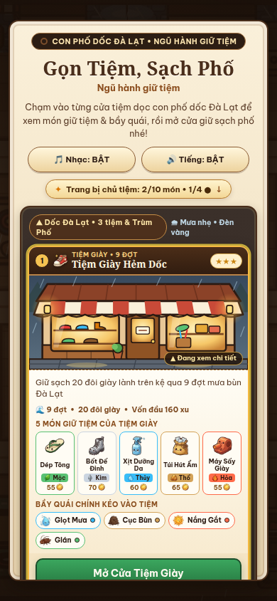 |
| Chạm ô mở bảng 5 món Tiệm Hoa | 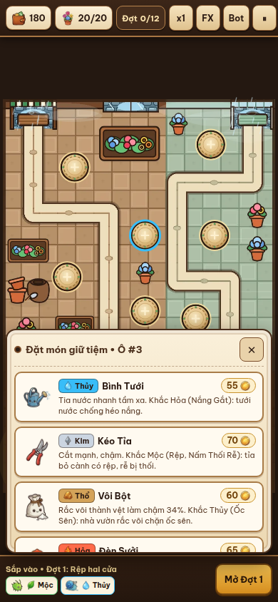 |
| Giao tranh 2 cửa vào | 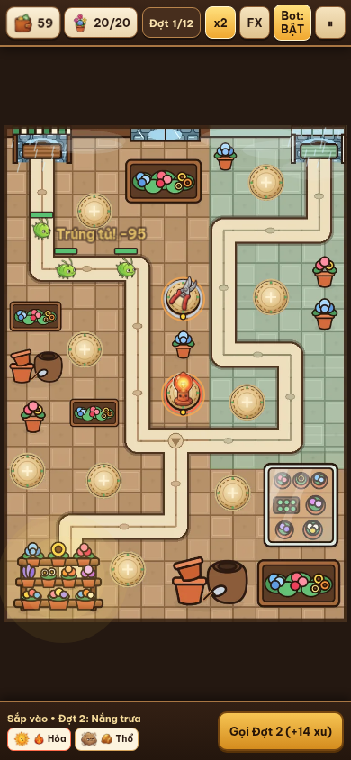 |
| Trùm Mùa Nồm Đổi hành! (Thủy → Mộc) | 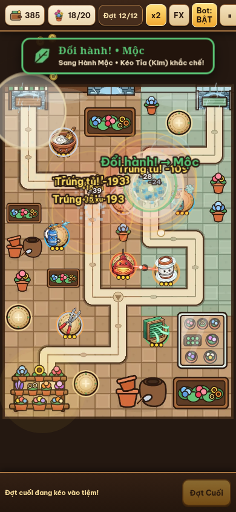 |
| Thắng 12 đợt Màn 3 với tháp Bậc 3 | 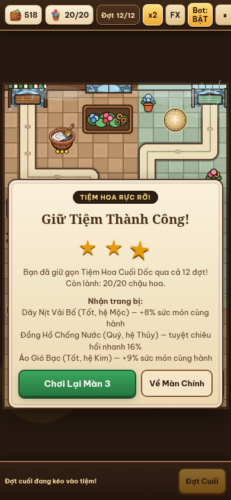 |

---

## 0. Màn 2 "Tiệm Bánh Đầu Phố" — Đã hoàn thành (Antigravity)

- **Nền bản đồ `public/assets/map_man2_tiem_banh.webp` (`720×1040` = 2× khung logic `360×520`, 79 KB):** Khớp 100% đường đi 2 ngả vòng quanh **quầy bánh gỗ** ở giữa (`x 60–300, y 80–290`) và 10 ô đặt món trong `src/core/shops/bakery.ts` (4 ô nằm gọn trong lòng quầy cùng tủ kính trưng bày bánh, thớt cán bột, giỏ bánh mì). Cửa tiệm ở trên giữa (`x=180, y=24`) mở ra phố mưa Đà Lạt có thảm nâu sọc không chữ nước ngoài; bao bột mì ở các góc; **kệ bánh gỗ đèn vàng ấm** đặt cuối đường `(300, 460)`.
- **Đủ bộ Sprite nền trong suốt vào Atlas (`public/assets/gon_tiem_atlas.webp`, `1024×1680`, 190 khung hình = 104 Màn 1 + 86 Màn 2, 513 KB):**
  - **5 món Tiệm Bánh × 4 bậc (`t1`, `t2`, `t3a`, `t3b`) × 3 khung hoạt ảnh đánh (60 khung):**
    - `bk_swatter` (**Kim**): *Vỉ Đập Ruồi* → *Vỉ Lưới Cán Dài* → *Vỉ Đập Đôi* (hai vỉ chéo) / *Vợt Điện Diệt Ruồi* (tia lửa điện xanh).
    - `bk_jar` (**Thổ**): *Hũ Sành Kín* → *Hũ Sành Nắp Nặng* → *Chum Sành Lớn* (chum sành hoa văn vàng) / *Hũ Lăn Dọc Quầy*.
    - `bk_fan` (**Mộc**): *Quạt Điện* (lồng quạt thoáng trong suốt) → *Quạt Đứng Hai Tốc* → *Quạt Trần Ba Cánh* / *Quạt Hộp Thổi Lùi*.
    - `bk_oven` (**Hỏa**): *Lò Nướng* → *Lò Nướng Hai Tầng* → *Lò Đối Lưu* / *Lò Bánh Mì Củi* (lò gạch vòm củi rực lửa).
    - `bk_fridge` (**Thủy**): *Tủ Mát* → *Tủ Mát Hai Cánh* → *Tủ Mát Giữ Tươi* / *Tủ Đông Gió Lạnh* (phủ băng tuyết).
  - **6 quái mới × 4 khung hoạt ảnh đi (24 khung) + dùng lại Chuột Màn 1 (`disrupt_water`):** *Hơi Ẩm* (`bk_humid`), *Bụi Bột* (`bk_flour`), *Ruồi* (`bk_fly`), *Mốc Bánh* (`bk_mold`), *Than Hồng* (`bk_ember`), *Than Vụn* (`bk_ember_mini`).
  - **Biểu tượng & đạo cụ:** Ổ bánh mì lành (`icon_bread_life`), kệ bánh gỗ (`prop_bakery_shelf`).
  - **Xoá sạch toàn bộ 11 khoá hình tạm Màn 2 (`bk_*`) khỏi `PLACEHOLDER_FRAME_ALIAS` trong `src/game/atlasIcons.ts`** (giữ nguyên các khoá `fl_*` tạm của Màn 3 do Claude vừa đẩy sườn).
- **Hiệu ứng & giao diện mới:**
  - **Đường sáng tương sinh (`tower.synergyFromUid`):** Vẽ đường sáng mảnh + hạt sáng trôi + mũi tên chỉ hướng theo màu hành món cho từ món cho → món nhận; bật chữ `+15%` ngay khi mới nối; chạm vào đường sáng mở thẻ giải thích tiếng Việt đời thường (vd *"Gió thổi lửa to hơn — Mộc sinh Hỏa"* trong `src/game/synergyText.ts`) và hiển thị dòng tương sinh ngay trong bảng nâng cấp.
  - **Khoá ô Màn 2 trên `TitleScene`:** Khoá tới khi `unlockedStage >= 2` trong bản lưu (qua Màn 1), nhưng `?stage=2` hoặc `?bot=1` vẫn mở thử ngay.
  - **Hiệu ứng đánh & chết riêng** cho cả 5 món và 6 quái Tiệm Bánh, mưa ngoài cửa giữa trên, đèn vàng ấm trên kệ bánh, biểu tượng ổ bánh mì trên HUD & hộp tổng kết Màn 2.
- **Tổng dung lượng `dist/`:** **2.4 MB** (dưới xa ngưỡng ≤ 5 MB). Không thay đổi bất kỳ tệp nào trong `src/core/`.

| Cảnh Màn 2 (`390×844`) | Ảnh kiểm chứng |
|---|---|
| Khoá Màn 2 trước khi qua Màn 1 | 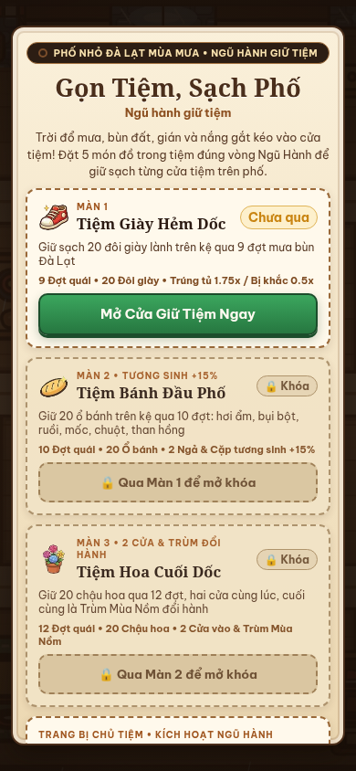 |
| Chạm ô trong quầy bánh mở 5 món | 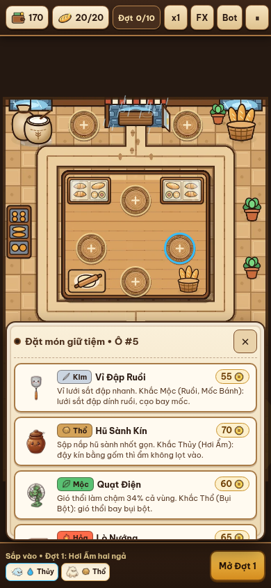 |
| Đường sáng tương sinh +15% & chạm xem giải thích | 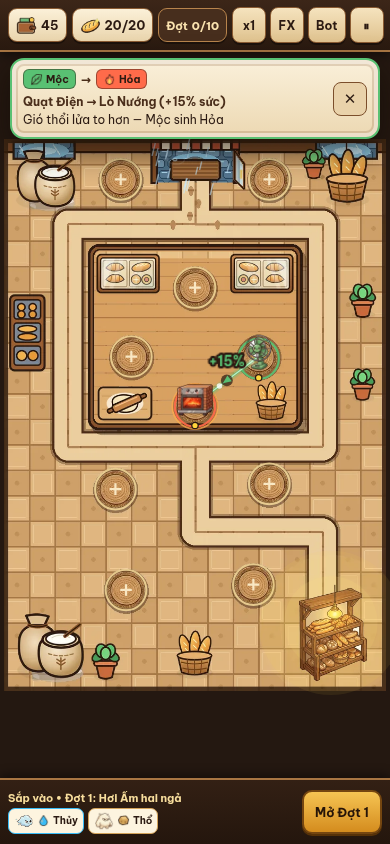 |
| Giao tranh 2 ngả đường | 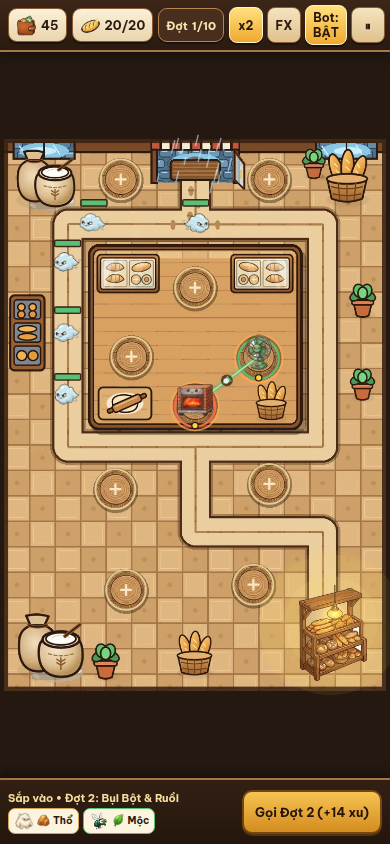 |
| Thắng 10 đợt Màn 2 với tháp Bậc 3 | 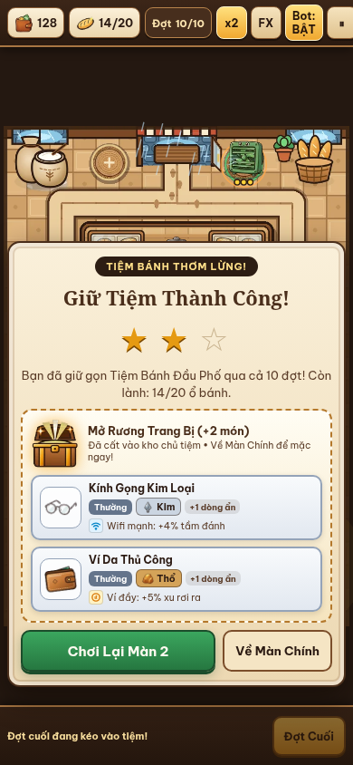 |

---

## 1. Năm góp ý Màn 1 từ `docs/REVIEW_LOG.md` đã làm đủ

1. **Nền trong suốt sạch cho mọi món & quái:** Toàn bộ 5 món giữ tiệm và 6 quái (+ Gián Con + Trùm Mùa Nồm) được tách nền trong suốt hoàn toàn (BFS flood-fill + gọt halo mép ngoài), kiểm tra trên nền caro không còn dính nền cũ hay viền trắng.
2. **Vẽ lại Con Gián đúng dáng gián hoạt hình dễ thương:** Thân dẹt bầu dục, cánh nâu bóng xếp chồng, đúng 2 râu dài uốn cong, 6 chân mảnh có gai nhỏ và đôi mắt tinh nghịch (không còn giống bọ cánh cứng tròn).
3. **Bỏ chữ "WELCOME" trên thảm chùi chân:** Cửa tiệm góc trên-trái dùng thảm chùi chân nâu sọc sạch, không có chữ nước ngoài.
4. **Nền bản đồ Màn 1 khớp 100% đường quái đi & 9 ô đặt món:** Bản đồ [`public/assets/map_man1_tiem_giay.webp`](../public/assets/map_man1_tiem_giay.webp) (`720×960` = đúng 2× khung `360×480`) ghép sàn gỗ thông ấm, góc vỉa hè đá ướt mưa, ghế thử giày, giỏ ô, kệ giày gỗ ở cuối đường `(304, 455)`, đường đi màu kem khớp chính xác 8 điểm nút `STAGE_1_DEFINITION.paths[0]` và 9 thảm cói tròn nằm đúng toạ độ 9 ô `STAGE_1_DEFINITION.pads` (rõ nét, không bị che khuất trên điện thoại cầm dọc).
5. **Nén Atlas WebP, tổng dung lượng `dist/` ≤ 5 MB:**
   - `dist/assets/gon_tiem_atlas.webp` (190 khung hình Màn 1 + Màn 2, `1024×1680`): **513 KB**
   - `dist/assets/gon_tiem_atlas.json`: **33 KB**
   - `dist/assets/map_man1_tiem_giay.webp`: **49 KB**
   - `dist/assets/map_man2_tiem_banh.webp`: **79 KB**
   - Phông chữ tiếng Việt offline (`Be Vietnam Pro` + `Noto Serif`, `.woff2`): **89 KB**
   - Mã game + Phaser (`index-*.js` + CSS): **1.60 MB**
   - **Tổng thư mục `dist/`:** **2.4 MB** (dưới rất xa ngưỡng 5 MB).

---

## 2. Chi tiết đã làm theo `docs/ANTIGRAVITY_BRIEF_LAM_DEP.md`

### Đổi tên & gán lại Ngũ Hành (`src/core/tdDefinitions.ts`, `src/core/elements.ts`, `src/core/tdEngine.ts`, `src/core/tdBot.ts`)
- **5 món giữ tiệm Màn 1 (đủ tên Bậc 1 → Bậc 2 → Nhánh A / Nhánh B đã duyệt):**
  - **Dép Tông (Mộc):** *Dép Tông Đế Dày* → *Dép Tông Kép (A)* / *Dép Tông Gai Bám (B)* — khắc **Thổ (Cục Bùn)**.
  - **Bốt Đế Đinh (Kim):** *Bốt Đinh Thép* → *Bốt Chốt Chì (A)* / *Bốt Đinh Quét Dọc (B)* — khắc **Mộc (Gián, Nấm Mốc)**.
  - **Xịt Dưỡng Da (Thủy):** *Bình Xịt Áp Lực* → *Xịt Bọt Tuyết Lạnh (A)* / *Xịt Vòi Xoáy (B)* — khắc **Hỏa (Nắng Gắt)**.
  - **Túi Hút Ẩm (Thổ):** *Giỏ Hút Ẩm Cỡ Đại* → *Thảm Hạt Hút Khô (A)* / *Chùm Túi Nổ Liên Hoàn (B)* — khắc **Thủy (Giọt Mưa)**.
  - **Máy Sấy Giày (Hỏa):** *Máy Sấy Hai Vòi* → *Máy Sấy Khử Khuẩn (A)* / *Máy Sấy Gió Nhiệt Cao (B)* — khắc **Kim (Chuột)** + hỗ trợ sấy khỏe món bên cạnh.
- **Quái Màn 1 gán đúng hành:** **Giọt Mưa (Thủy)**, **Cục Bùn (Thổ)**, **Gián / Gián Con (Mộc)**, **Nắng Gắt (Hỏa)** (cùng định nghĩa sẵn **Chuột — Kim**, **Nấm Mốc — Mộc**, **Trùm Mùa Nồm — Thủy**).

### Bước B — Đủ bộ Sprite & Atlas (`scripts/build_art_assets.py`, `public/assets/`)
- 5 món × 4 bậc/nhánh (có khác biệt hình ảnh rõ rệt ở Bậc 2, 3A, 3B) × **3 khung hoạt ảnh bắn** = 60 khung hình.
- 6 quái + Gián Con + Trùm Mùa Nồm × **4 khung hoạt ảnh đi** = 32 khung hình.
- Đạo cụ & biểu tượng: thảm cói tròn, kệ giày gỗ, 5 biểu tượng hành (giọt nước, cục đất, chiếc lá, mũi kim, ngọn lửa), tiền xu, chiếc ví, đôi giày lành, đạn dép tông & gói hút ẩm.

### Bước C — Hiệu ứng chiến đấu & không khí ngày mưa (`src/scenes/TdStageScene.ts`, `src/game/preferences.ts`)
- **5 kiểu đòn đánh riêng kèm bảng màu hành** (Thủy `#38bdf8`, Thổ `#d4a359`, Mộc `#59c173`, Kim `#cbd5e1`, Hỏa `#ff6b4a`): dép tông xoay vèo, bốt đạp sóng xung kích + bụi, xịt phun sương lam phủ vùng, gói hút ẩm bay cầu vồng bung hạt hút ẩm, máy sấy thổi luồng hơi ấm cam đỏ.
- **Hoạt ảnh & 6 hiệu ứng chết riêng:** món giật nảy + lóe sáng khi đánh; quái nhún khi đi + chớp trắng khi trúng; khi chết: Giọt Mưa bắn tóe nước, Cục Bùn vỡ vụn đất, Gián lật ngửa xoay tròn, Chuột quay đầu chạy biến, Nấm Mốc tan bụi bào tử, Nắng Gắt thu nhỏ tắt phụt.
- **Không khí Đà Lạt ngày mưa:** mưa rơi xiên ngoài cửa kính góc trên-trái, vũng nước lăn tăn, ánh đèn vàng ấm trên kệ giày cuối tiệm.
- **Phản hồi sướng tay:** chữ **"Trúng tủ!"** to nổi bật + rung nhẹ khi khắc chế; xu và tiền giấy bay vòng vào **Chiếc Ví** (nảy nhẹ khi nhận tiền); thắng màn có pháo sáng + 1–3 sao rơi lần lượt.
- **Tuỳ chọn "Giảm hiệu ứng" (`FX` / `Nhẹ`):** tự bật khi thiết bị đặt `prefers-reduced-motion: reduce`, có nút chuyển trực tiếp trên thanh trên và lưu vào `localStorage`.

### Bước D — Giao diện hộp giày / thẻ giá treo & Phông chữ tiếng Việt offline (`src/ui/styles.css`, `src/scenes/TitleScene.ts`, `src/assets/fonts/`)
- Khung hộp giày giấy kraft ấm có viền gỗ & nét khâu đứt, thẻ giá treo có lỗ xỏ cho bảng mở màn, bảng đặt món, bảng nâng cấp (hiện rõ hình ảnh từng nhánh 3A / 3B) và hộp tổng kết.
- Thanh báo đợt phía dưới hiển thị đồng thời **hình con quái + biểu tượng hành Ngũ Hành** của đợt sắp kéo vào tiệm.
- Cài sẵn offline 2 bộ phông tiếng Việt **SIL Open Font License 1.1**: **Be Vietnam Pro** (nội dung / nút) và **Noto Serif** (tiêu đề), không gọi bất kỳ tài nguyên mạng ngoài nào (xem [`CREDITS.md`](../CREDITS.md)).

---

## 3. Kết quả kiểm chứng cân bằng sau khi gán lại Ngũ Hành Màn 1

| Kiểm tra | Kết quả sau gán lại hành | Mục tiêu REVIEW_LOG |
|---|---|---|
| **Bot phối hợp đúng 5 hành (`sim_man1.ts`)** | **Thắng, còn 17/20 đôi giày (3 sao, mất 3 đôi)** | Đạt (thắng có mất vài mạng, không phải 20/20 dễ dàng) |
| **Lấp 9 ô toàn 1 món (`all` & `all-noupg`)** | **Thua cả 10/10 lần (0/20 đôi)** | Đạt |
| **Giới hạn 1–4 món đơn lẻ (`limit 1..4`)** | **Thua cả 8/8 lần (0/20 đôi)** | Đạt |
| **60 lần đặt ngẫu nhiên (`random-mix 60`)** | **Thắng 7/60 (11.7%), Thua 53/60, 0/60 lần 3 sao** *(lives: `5,5,6,6,7,10,14`)* | Đạt (≤ 30% thắng, hầu như không 3 sao) |
| **400 kế hoạch ngẫu nhiên (`search_man1.ts`)** | **Thua 187, 1 sao 73, 2 sao 94, 3 sao 46 — tốt nhất còn 20/20** | Đạt (3 sao vẫn đạt được khi tính kỹ, cách đặt quyết định thắng thua) |

---

## 4. Ảnh so sánh Trước / Sau trên điện thoại cầm dọc (`390×844`)

| Cảnh | Trước khi làm đẹp (`dep_*_truoc_*.png`) | Sau khi làm đẹp (`dep_*_sau_*.png`) |
|---|---|---|
| **1. Màn hình chính** |  |  |
| **2. Chạm ô đặt món** |  |  |
| **3. Giao tranh Màn 1** |  |  |
| **4. Thắng màn & Chấm sao** | 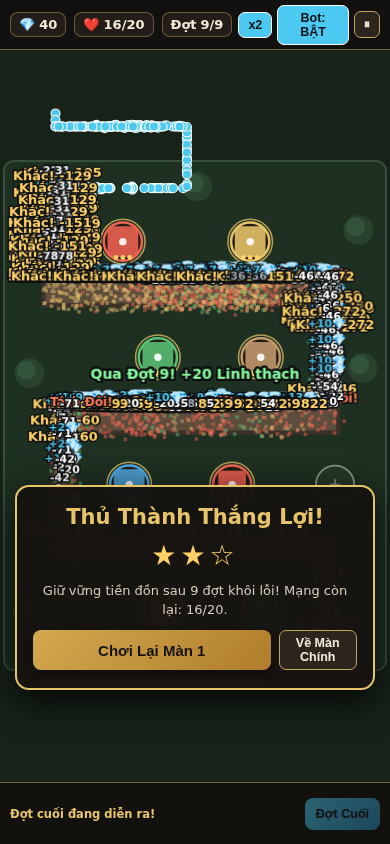 |  |

---

## 5. Lệnh kiểm tra nhanh

```bash
npm test          # 27/27 unit test qua (Màn 1, Màn 2, Màn 3 & Ngũ Hành)
npm run build     # dist/ tổng cộng 2.4 MB (<= 5 MB)
npm run test:e2e  # 4/4 Playwright điện thoại dọc 390x844 qua (Màn 1 + khoá Màn 2 + tương sinh & Màn 2), 0 lỗi console, 0 mạng ngoài
```
