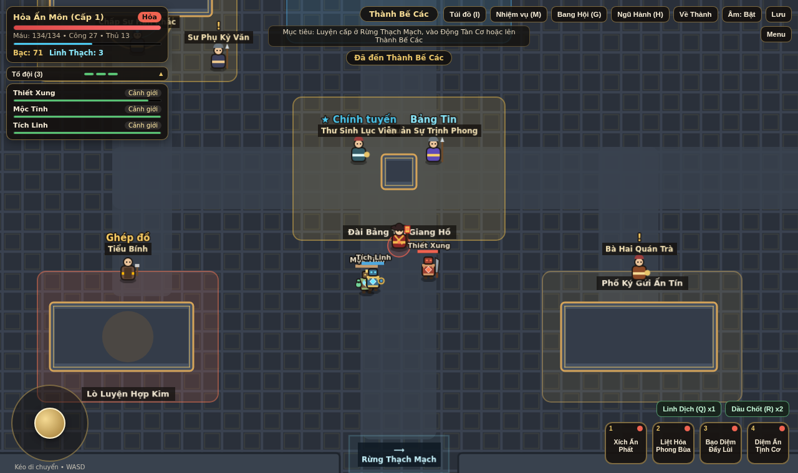
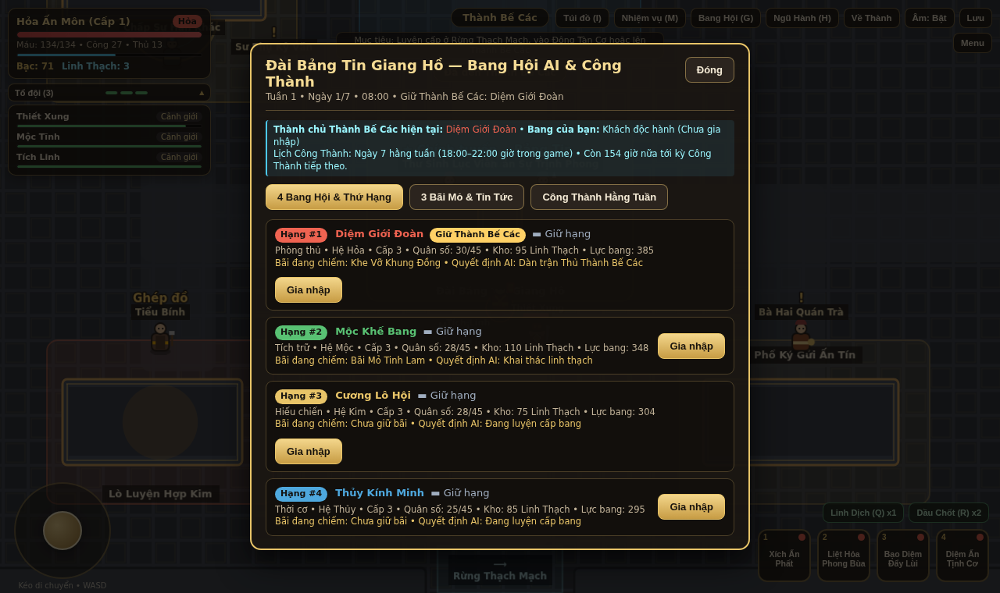
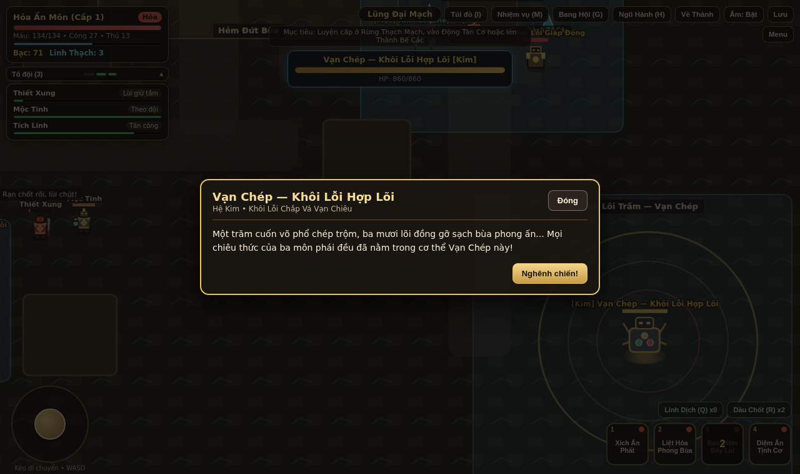
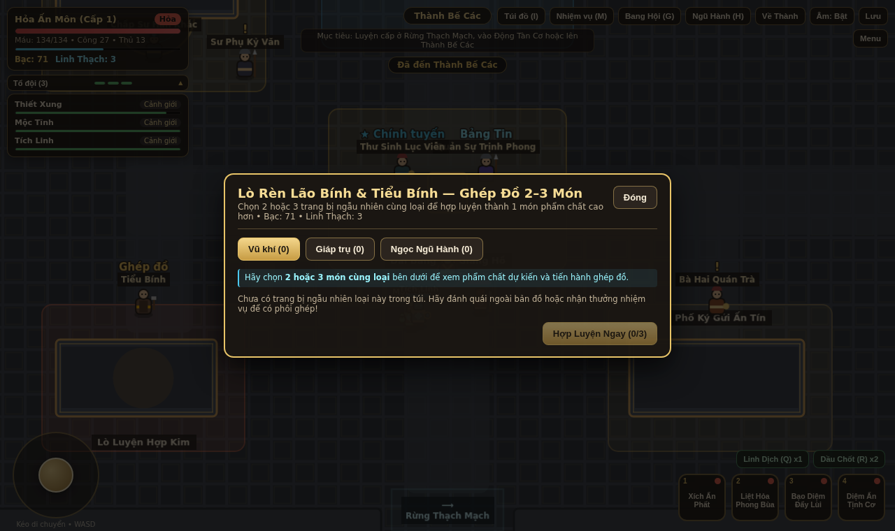
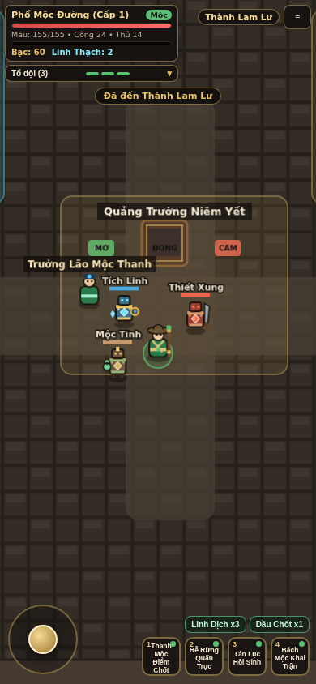
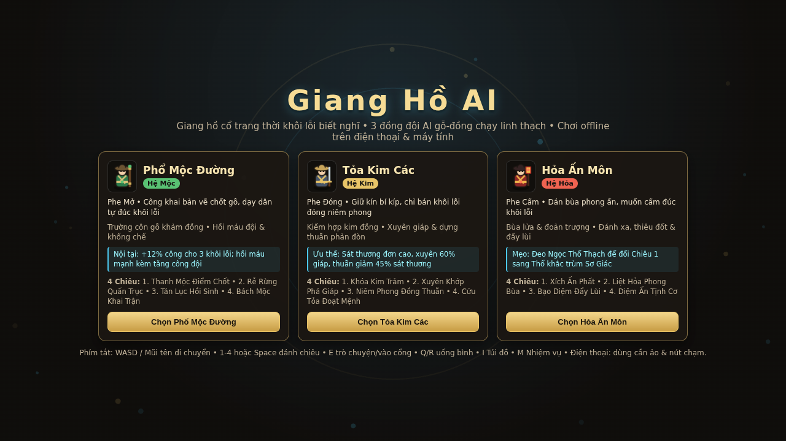
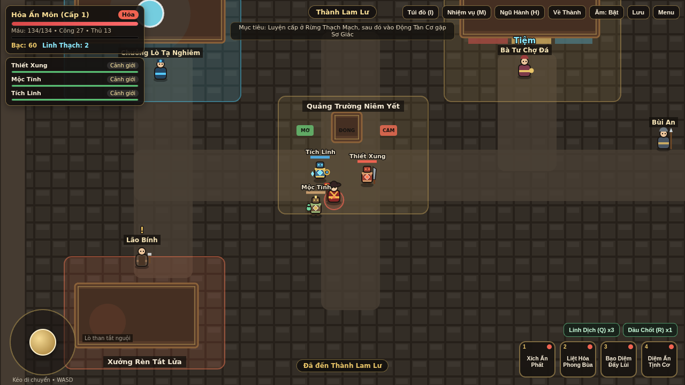
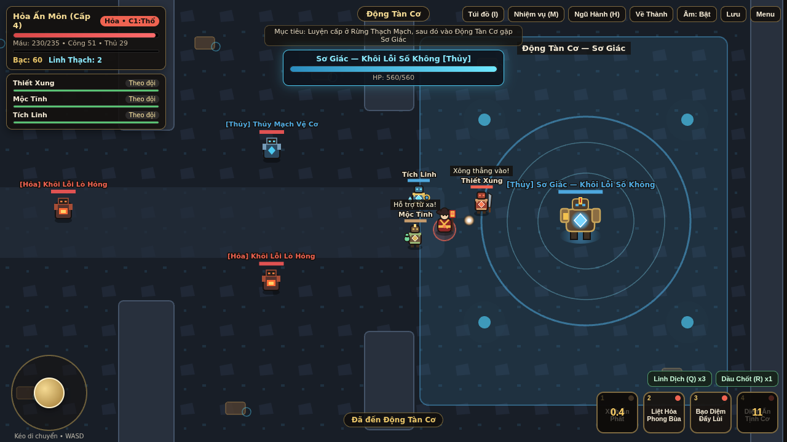

GĐ2 XONG

# Tiến độ phát triển — Giang Hồ AI (Giai đoạn 1 & Giai đoạn 2)

Cập nhật: 22/11/2026 • Nhánh: `main` • Công nghệ: Phaser 3 + TypeScript + Vite (web tĩnh offline hoàn toàn trong `dist/`, không gọi mạng, không khoá API, không quảng cáo, không theo dõi).

---

## 1. Đã hoàn thành trong Giai đoạn 2 — Thế giới sống

### Bước 0: Hoàn thiện phần dở từ Giai đoạn 1
- **Giao diện điện thoại cầm dọc (`src/scenes/UIScene.ts`, `src/ui/styles.css`):**
  - Tự động phát hiện màn hình dọc (`portrait` / chiều rộng `<= 640px`), thu gọn khung 3 đồng đội AI thành thanh mảnh một dòng (chạm để bung/thu).
  - Gom cụm nút menu trên-phải (`Nhiệm vụ`, `Bang Hội`, `Túi đồ`, `Ngũ Hành`, `Lưu`) vào nút trình đơn **`≡`** đóng/mở gọn gàng.
  - Dời dòng thông báo (toast) lên sát dưới thanh đỉnh, không bao giờ đè lên nút **Linh Dịch (Q)** hay **Dầu Chốt (R)**.
  - Phần bản đồ chơi luôn nhìn rõ **hơn 2/3 diện tích màn hình** trên điện thoại cầm dọc (`390×844`).
- **Kiểm thử tự động bằng trình duyệt thật (`npm run test:e2e`, `playwright.config.ts`, `e2e/game.spec.ts`):**
  - Chạy Chromium headless trực tiếp trên bản build tĩnh `dist/`, chặn mọi yêu cầu mạng ngoài (`page.route`) để chứng minh game chạy **100% offline**, không có lỗi `console.error` hay `pageerror`.
  - Gồm 4 kịch bản E2E tự động:
    1. Đi bộ qua 3 bản đồ GĐ1 tới **Trùm Sơ Giác**.
    2. Kiểm tra màn hình điện thoại cầm dọc (`390×844`): diện tích bản đồ `>= 2/3`, thu gọn tổ đội, nút `≡`, bảng **Đài Bảng Tin Giang Hồ** hiển thị đủ 4 bang hội + tab bãi mỏ & công thành vừa khít màn hình dọc, và toast không đè nút bình thuốc.
    3. Đi bộ qua 4 bản đồ GĐ2: **Thành Lam Lư → Rừng Thạch Mạch → Thành Bế Các → Lũng Đại Mạch → gặp Trùm Vạn Chép**.
    4. Nâng cấp bản lưu cũ từ Giai đoạn 1 (`giang_ho_ai_save_v1`) sang Giai đoạn 2 (`giang_ho_ai_save_v2`) giữ nguyên cấp độ, túi đồ, trang bị đang mặc và tiến độ nhiệm vụ.

### Hai bản đồ mới nối liền mạch với 3 bản đồ cũ
- **Thành Bế Các** (`src/scenes/InnerCityScene.ts`, `map_inner_city`, khu an toàn tự hồi máu nối từ cổng Bắc Rừng Thạch Mạch):
  - **Đài Bảng Tin Giang Hồ** ở trung tâm thành + NPC **Quản Sự Trịnh Phong**, **Thư Sinh Lục Viễn** và **Cột Đại Kỳ** đổi màu theo bang hội đang giữ thành.
  - **Mật Khố Tỏa Chốt & Sân Công Thành Bắc Môn** cùng đại diện 3 môn phái: **Trưởng Lão Mộc Thanh** (Phổ Mộc Đường), **Chấp Sự Hàn Khắc** (Tỏa Kim Các), **Chưởng Ấn Nghiêm Liệt** (Hỏa Ấn Môn).
  - **Lò Luyện Hợp Kim & Phố Ký Gửi Ấn Tín:** **Tiểu Bính** (học trò Lão Bính hỗ trợ ghép đồ 2–3 món ngay tại Thành Bế Các), **Bà Hai Quán Trà**, **Sư Phụ Kỷ Văn**.
- **Lũng Đại Mạch** (`src/scenes/ValleyScene.ts`, `map_valley`, nối từ cổng Đông Thành Bế Các):
  - **Cửa Tây Lũng Đại Mạch** có **Đạo Sĩ Tề Minh** kiểm tra bùa phong ấn.
  - **3 Bãi Mỏ Linh Thạch tranh chấp** có cờ hiệu bang hội chiếm đóng và đệ tử AI tuần tra ngoài bản đồ:
    1. **Bãi Mỏ Tinh Lam** (`spot_valley_west`)
    2. **Hẻm Đứt Bùa** (`spot_valley_north`)
    3. **Khe Vỡ Khung Đồng** (`spot_valley_east`)
  - **Tế Đàn Lõi Trầm (Đông-Nam):** đấu trường của **Trùm Vạn Chép — Khôi Lỗi Hợp Lõi (Hệ Kim, cấp 7)** với 3 chiêu thức (**Sao Chép Loạn Chiêu**, **Mở Khóa Quá Tải**, **Hợp Lõi Cướp Mạch**).

### 4 Bang hội AI tự sinh tồn, chiếm bãi & Công Thành mỗi tuần (`src/core/guildSystem.ts`, `src/core/worldClock.ts`)
- **4 Bang hội AI quyết định hoàn toàn bằng cây quyết định / chấm điểm tại máy (`evaluateGuildDecision`), không gọi LLM:**
  - **Cương Lô Hội** (`guild_orthodox` — Hệ Kim): ưu tiên giữ thành / tham gia Công Thành và giữ bãi mỏ ổn định.
  - **Mộc Khế Bang** (`guild_merchant` — Hệ Mộc): ưu tiên khai thác bãi mỏ giàu linh thạch (`mine_resources`) khi kho chưa đầy.
  - **Thủy Kính Minh** (`guild_scholar` — Hệ Thủy): ưu tiên chiêu mộ đệ tử và tích lũy linh thạch chờ thời cơ.
  - **Diệm Giới Đoàn** (`guild_aggressive` — Hệ Hỏa): chủ động tranh bãi (`contest_spot`) và dồn lực Công Thành vào Ngày 7.
- **Tự chạy nền và giới hạn bù thời gian khi tắt game mở lại (theo ghi chú 1 trong `docs/REVIEW_LOG.md`):**
  - Khi người chơi đang ở bất kỳ bản đồ nào, đồng hồ thế giới (`WorldClockState`) vẫn nhảy mỗi giờ trong game và cập nhật cả 4 bang hội.
  - Khi người chơi đóng trình duyệt rồi mở lại bản lưu (`continueSavedGame`), hệ thống tính số giờ trong game đã trôi qua theo `lastRealTimestampMs` nhưng **giới hạn tối đa 1 tuần trong game (`MAX_OFFLINE_CATCHUP_HOURS = 168` giờ = 168 bước mô phỏng)** bằng hàm `computeOfflineCatchupHours()` trong [`src/core/worldClock.ts`](../src/core/worldClock.ts). Nhờ vậy mở lại sau nhiều ngày game vẫn vào ngay lập tức, không bao giờ đơ máy.
- **Tương tác người chơi & Công Thành mỗi tuần (Ngày 7 lúc 20:00):**
  - Người chơi có thể **Xin vào bang**, **Rời bang**, **Góp 12 Linh Thạch** tăng uy danh, hoặc bấm **Chạy 1 giờ thế giới** / **Tới kỳ Công Thành** ngay trên Đài Bảng Tin để quan sát diễn biến.
  - Ngoài bản đồ **Lũng Đại Mạch**, đệ tử tuần tra của 4 bang phản ứng trực tiếp theo quan hệ với người chơi: **Thân thiện / Cùng bang** (`friendly`) truyền linh khí hồi máu; **Tránh né** (`avoid`) chủ động lùi nhường bãi; **Đối địch** (`attack`) cảnh báo áp sát và giao tranh giữ bãi.

### Nhiệm vụ chính nối tiếp Sơ Giác (6 bước, rẽ nhánh danh tiếng 3 phái) & 3 nhiệm vụ phụ mới
- **Nhiệm vụ chính GĐ2 — *"Tiếng Vọng Từ Động Tàn Cơ"* (`mq_gd2_echo_from_cave`, 6 bước):**
  1. Mang Bản Ghi Lõi Sơ Giác tới **Thư Sinh Lục Viễn** tại Đài Bảng Tin Giang Hồ (Thành Bế Các).
  2. Gặp **Chấp Sự Hàn Khắc** trước Mật Khố Tỏa Chốt nghe quan điểm của 3 môn phái.
  3. **Chọn hướng xử lý Bản Ghi Lõi Sơ Giác (rẽ nhánh & đổi danh tiếng / thái độ 3 môn phái `Thân hữu` / `Trung lập` / `Đề phòng`):**
     - **Hướng Mở (Phổ Mộc Đường):** giao cho **Trưởng Lão Mộc Thanh** công khai bản vẽ (`+28` Phổ Mộc Đường).
     - **Hướng Đóng (Tỏa Kim Các):** giao cho **Chấp Sự Hàn Khắc** niêm phong trong Mật Khố (`+28` Tỏa Kim Các).
     - **Hướng Cấm (Hỏa Ấn Môn):** giao cho **Chưởng Ấn Nghiêm Liệt** thiêu hủy và dán đại bùa phong ấn (`+28` Hỏa Ấn Môn).
  4. Tiến vào **Lũng Đại Mạch** tuần tra các bãi mỏ đang tranh chấp.
  5. Thu thập đủ chứng cứ chép trộm và phá bùa tại Lũng Đại Mạch.
  6. Hạ **Trùm Vạn Chép — Khôi Lỗi Hợp Lõi** tại Tế Đàn Lõi Trầm và quay về báo cho **Thư Sinh Lục Viễn** → thưởng **Ngọc Lõi Thức Tỉnh**.
- **3 nhiệm vụ phụ mới (lời thoại tiếng Việt viết sẵn, gắn với chuyện AI đời thực):**
  1. **Trưởng Lão Hai Giọng** (`sq_elder_two_voices` — ánh xạ *giả giọng giả mặt / deepfake*): giúp **Bà Hai Quán Trà** truy dấu ra Bãi Mỏ Tinh Lam, vạch mặt **Khôi Lỗi Giả Thanh** và thu hồi **Mặt Nạ Gỗ Giả Thanh**.
  2. **Cuốn Phổ Mất Dấu** (`sq_lost_martial_scroll` — ánh xạ *lấy dữ liệu / bí kíp bị chép trộm dạy khôi lỗi*): giúp **Sư Phụ Kỷ Văn** thu hồi **3 Tập Chép Lén Võ Phổ** từ đám **Khôi Lỗi Chép Trộm** ở Khe Vỡ Khung Đồng.
  3. **Người Gỡ Bùa Đêm** (`sq_night_talisman_breaker` — ánh xạ *phá luật an toàn AI / jailbreak khôi lỗi*): giúp **Đạo Sĩ Tề Minh** tiến vào Hẻm Đứt Bùa hạ đám **Khôi Lỗi Vỡ Bùa** và dán lại **3 Trụ Bùa Phong Ấn**.

### Trang bị dòng chỉ số ngẫu nhiên & Ghép đồ tại Lò Rèn (`src/core/equipmentGen.ts`)
- **Trang bị rơi từ quái có 1–3 dòng chỉ số phụ ngẫu nhiên theo 4 bậc độ hiếm (`Thường`, `Tinh Xảo`, `Hiếm Có`, `Tuyệt Phẩm`)** với 8 dòng chỉ số (**Sắc Bén**, **Kiên Cố**, **Sinh Khí**, **Hiểm Yếu**, **Phá Khớp**, **Khinh Bộ**, **Hộ Mệnh**, **Đồng Tâm**) bằng bộ sinh số giả ngẫu nhiên có hạt giống (`mulberry32`).
- **Ghép 2–3 món cùng ô tại Lò Rèn (`craftEquipmentFromItems`):** nói chuyện với **Lão Bính** (Thành Lam Lư) hoặc **Tiểu Bính** (Thành Bế Các) hoặc bấm nút **Ghép đồ Thợ Rèn (2–3 món)** trong Túi đồ để chọn 2–3 món cùng ô (`Vũ khí`, `Giáp`, `Ngọc`), xem trước tỷ lệ lên phẩm chất và ghép thành 1 món mới mạnh hơn.
- **Cân bằng Ngũ Hành trước Trùm Vạn Chép (Hệ Kim, cấp 7):**
  - **Phổ Mộc Đường (Mộc bị Kim khắc)** khi đeo **Ngọc Hỏa Tinh** (truyền hệ Hỏa vào Chiêu 1 để khắc Kim `1.35x`, kèm kháng Kim 25%) hoặc **Ngọc Lõi Thức Tỉnh** cùng 3 đồng đội AI (**Thiết Xung** hệ Hỏa khắc Kim) hạ được **Trùm Vạn Chép** ở cấp đề xuất 7 — đã kiểm chứng bằng test tự động trong `tests/combat.test.ts`.

---

## 2. Đã hoàn thành trong Giai đoạn 1 (Nền tảng)

- **3 bản đồ GĐ1:** **Thành Lam Lư** (`TownScene`), **Rừng Thạch Mạch** (`ForestScene`), **Động Tàn Cơ** (`CaveScene`) + **Trùm Sơ Giác — Khôi Lỗi Số Không (Thủy)**.
- **3 môn phái & 12 chiêu thức Ngũ Hành:** **Phổ Mộc Đường (Mộc)**, **Tỏa Kim Các (Kim)**, **Hỏa Ấn Môn (Hỏa)** + cơ chế **Ngọc Ngũ Hành truyền hệ vào Chiêu 1**.
- **3 đồng đội AI khôi lỗi bằng cây quyết định (`src/core/aiDecisionTree.ts`):** **Thiết Xung (Liều — Hỏa)**, **Mộc Tĩnh (Cẩn thận — Thổ)**, **Tích Linh (Tham đồ — Thủy)**.
- **2 nhiệm vụ phụ GĐ1:** *Lò Than Chưa Tắt* (Lão Bính) và *Bản Đồ Không Có Thật* (Bách Thông).

---

## 3. Cách cài đặt, kiểm thử và chạy

```bash
# Cài phụ thuộc
npm install

# Chạy toàn bộ kiểm thử đơn vị tự động (43/43 test)
npm test

# Đóng gói bản web tĩnh offline vào thư mục dist/
npm run build

# Chạy kiểm thử tự động bằng trình duyệt thật trên bản build dist/ (4/4 kịch bản E2E)
npm run test:e2e

# Chạy máy chủ phát triển
npm run dev
```

- **Dung lượng gói JS (`dist/assets/index-*.js`):** `1,695.55 kB` (~1.66 MB, gzip `403.86 kB`), nhẹ dưới ngưỡng 2 MB theo yêu cầu.

---

## 4. Kết quả kiểm thử tự động (`npm test` & `npm run test:e2e`)

- `tests/elements.test.ts` — **5 test qua**: vòng Ngũ Hành tương khắc (`1.35x` / `0.75x` / `1.0x`) và tương sinh.
- `tests/combat.test.ts` — **9 test qua**: sát thương, xuyên giáp, kháng hệ, khiên, chí mạng, Ngọc đổi hệ Chiêu 1, Hỏa Ấn Môn hạ Sơ Giác (Thủy) ở cấp 4, và **Phổ Mộc Đường (Mộc) đeo Ngọc Hỏa Tinh hạ Trùm Vạn Chép (Kim) ở cấp 7**.
- `tests/aiDecisionTree.test.ts` — **8 test qua**: cây quyết định của 3 tính cách Liều / Cẩn thận / Tham đồ.
- `tests/equipmentGen.test.ts` — **6 test qua**: sinh trang bị 1–3 dòng ngẫu nhiên có seed, cộng chỉ số phụ vào chiến đấu, ghép 2–3 món cùng ô tại Lò Rèn, từ chối ghép khác ô.
- `tests/guildSystem.test.ts` — **5 test qua**: cây quyết định 4 bang hội AI, mô phỏng tranh bãi theo giờ, Công Thành mỗi tuần (Ngày 7 giờ 20:00), gia nhập/rời bang và **giới hạn bù thời gian tối đa 168 giờ (1 tuần trong game) khi mở lại bản lưu cũ**.
- `tests/reputationAndQuests.test.ts` — **3 test qua**: danh tiếng & thái độ 3 môn phái theo lựa chọn Mở / Đóng / Cấm, chuỗi 6 bước nhiệm vụ chính GĐ2 và 3 nhiệm vụ phụ mới.
- `tests/systems.test.ts` — **7 test qua**: mua/bán/mặc đồ, chặn bán đồ nhiệm vụ, va chạm bản đồ, lưu/đọc `v2` và nâng cấp bản lưu `giang_ho_ai_save_v1` từ GĐ1 lên `v2`.
- `e2e/game.spec.ts` (`npm run test:e2e`) — **4 kịch bản trình duyệt thật qua 100%**: kiểm chứng đi bộ qua cả 5 bản đồ, gặp cả 2 Trùm (Sơ Giác & Vạn Chép), HUD điện thoại cầm dọc + Đài Bảng Tin Giang Hồ, và nâng cấp bản lưu GĐ1 hoàn toàn offline.

---

## 5. Ảnh chụp màn hình thực tế

### Giai đoạn 2 — Thành Bế Các (Đài Bảng Tin Giang Hồ, Lò Luyện Hợp Kim & Phố Ký Gửi Ấn Tín)


### Giai đoạn 2 — Đài Bảng Tin Giang Hồ (4 Bang hội AI, 3 Bãi mỏ & Công Thành hằng tuần)


### Giai đoạn 2 — Lũng Đại Mạch & Trùm Vạn Chép (Khôi Lỗi Hợp Lõi)


### Giai đoạn 2 — Lò Rèn ghép trang bị 2–3 món & Dòng chỉ số ngẫu nhiên


### Giai đoạn 2 — Giao diện điện thoại cầm dọc (390×844, thu gọn tổ đội & trình đơn `≡`)


### Giai đoạn 1 — Màn hình khởi đầu, Thành Lam Lư, Rừng Thạch Mạch & Động Tàn Cơ




