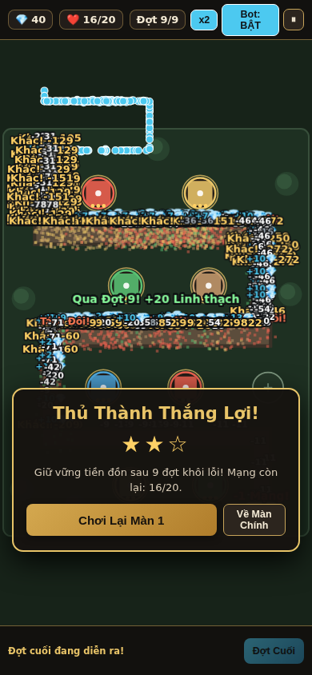

# Tiến độ phát triển — Giang Hồ AI (Đổi hướng: Game Thủ Thành)

Cập nhật: 22/11/2026 • Nhánh: `main` • Trạng thái hiện tại: **Đã gắn tên chính thức (sau `NAMES THỦ THÀNH: ĐỒNG Ý`) + Đã sửa đủ 5 việc cân bằng Màn 1 theo `docs/REVIEW_LOG.md`, chờ Claude chấm lại "VUI" Màn 1 (chưa làm Màn 2–3, chưa làm `ANTIGRAVITY_BRIEF_LAM_DEP.md`)**.

---

## 1. Năm việc đã sửa ở Màn 1 (theo `docs/REVIEW_LOG.md` & `docs/review/2026-11-22_sim_man1.ts`)

1. **Siết độ khó Màn 1 (`src/core/tdDefinitions.ts`):**
   - Đã gắn tên chính thức đã duyệt (`NAMES THỦ THÀNH: ĐỒNG Ý`): **Mộc Tiêu Khôi**, **Kim Trọng Khôi**, **Thủy Hàn Khôi**, **Hỏa Lôi Khôi**, **Thổ Trấn Khôi** (cùng tên bậc 2 và 2 nhánh bậc 3); 4 loại quái Màn 1 (**Khôi Lỗi Chân Gió**, **Thạch Giáp Khôi Lỗi**, **Phi Dực Khôi Lỗi**, **Song Thể Khôi Lỗi** / **Tiểu Hỏa Khôi**) và tên màn **Màn 1: Đường Mòn Rừng Thạch Mạch**.
   - Giảm linh thạch khởi đầu xuống `160`, giảm thưởng qua đợt (`14..20`), máu quái tăng dần mạnh theo từng đợt (`hpScale` từ `0.9` ở Đợt 1 lên `4.05` ở Đợt 9), và 3 đợt cuối (Đợt 7–9) xuất quân dồn dập (`intervalSec` ngắn `0.38s–1.12s`).
2. **Ngũ hành tạo khác biệt rõ rệt (`src/core/tdEngine.ts`, `src/core/tdDefinitions.ts`):**
   - Toàn bộ **9/9 đợt của Màn 1 đều trộn từ 2 đến 4 hệ quái** để không một loại quân đơn lẻ nào cân được cả đợt.
   - Tăng biên độ khắc chế Ngũ Hành riêng cho thủ thành lên **`1.75x` khi khắc** (kèm xuyên 75% giáp) và **`0.50x` khi bị khắc**.
   - Quái máu trâu (**Thạch Giáp Khôi Lỗi** — Hệ Thổ) và quái bay (**Phi Dực Khôi Lỗi** — Hệ Mộc) có lớp giáp kháng mạnh đòn đánh không khắc hệ (giảm thêm 48% sát thương với Thạch Giáp và 35% với Phi Dực nếu quân bắn không khắc hệ), đồng thời quân tự ưu tiên ngắm mục tiêu mà mình khắc hệ trong tầm bắn.
   - Khi người chơi phối hợp đủ 5 hệ quân trên sân và đặt **Thổ Trấn Khôi** ở tâm trận (`pad_4`), kích hoạt cộng hưởng **Ngũ Hành Tương Sinh Trận** giúp giữ vững phòng tuyến trước 3 đợt tổng kích cuối.
3. **Đưa toàn bộ kiểm tra mô phỏng vào test tự động (`tests/tdEngine.test.ts`):**
   - Kiểm tra tự động với seed cố định:
     - Lấp toàn bộ 9 ô bằng 1 loại quân duy nhất (cả 5 loại, có hoặc không nâng cấp): **THUA 10/10**.
     - Chỉ đặt 1–4 quân (Mộc hoặc Hỏa, nâng tối đa): **THUA 8/8**.
     - 60 lần đặt loại quân ngẫu nhiên (`seed 1..60`): **thắng 10/60 (16.7% <= 30%)**, chỉ 1/60 lần đạt 3 sao.
     - Bot chơi đúng hệ phối hợp 5 loại quân (`runBotTurn`): **THẮNG với 11/20 mạng còn lại (2 sao)** — có lúc suýt thua ở 3 đợt cuối, không còn 20/20 dễ dàng.
4. **Ẩn nút "Bot" khỏi người chơi bình thường (`src/scenes/TdStageScene.ts`, `e2e/game.spec.ts`):**
   - Mặc định giao diện chỉ hiện nút tốc độ `x1/x2` và tạm dừng `⏸`. Nút `Bot` chỉ xuất hiện khi mở đường dẫn có `?bot=1` để phục vụ kiểm thử tự động.
5. **Chạy lại script mô phỏng của Claude (`docs/review/2026-11-22_sim_man1.ts`) và ghi bảng kết quả dưới đây.**

---

## 2. Bảng kết quả chạy `docs/review/2026-11-22_sim_man1.ts` sau khi sửa

Lệnh chạy:
```bash
npx esbuild docs/review/2026-11-22_sim_man1.ts --bundle --platform=node --outfile=/tmp/sim.cjs && node /tmp/sim.cjs
```

| Cách chơi (trong `2026-11-22_sim_man1.ts`) | Kết quả trước khi sửa | Kết quả sau khi sửa | Đánh giá so với mục tiêu REVIEW_LOG |
|---|---|---|---|
| **Bot phối hợp đúng hệ (`bot`)** | Thắng, 20/20 mạng | **Thắng, 11/20 mạng (2 sao)** | Đạt (thắng nhưng mất 9 mạng ở các đợt dồn dập, đạt 2 sao) |
| **Lấp 9 ô toàn 1 loại quân, có nâng cấp (`all`)** | Thắng 4/5 loại (20/20 mạng) | **Thua cả 5/5 loại (0/20 mạng)** | Đạt (Mộc, Kim, Thủy, Hỏa, Thổ đều thua) |
| **Lấp 9 ô toàn 1 loại quân, không nâng cấp (`all-noupg`)** | Thắng 4/5 loại (20/20 mạng) | **Thua cả 5/5 loại (0/20 mạng)** | Đạt |
| **60 lần đặt loại quân ngẫu nhiên (`random-mix 60`)** | Thắng 60/60 (100% đạt 20/20 mạng) | **Thắng 10/60 (16.7%), Thua 50/60** *(mạng các lần thắng: `1,5,6,6,7,7,8,8,10,20` — chỉ 1/60 lần 3 sao)* | Đạt (<= 30% thắng, hầu như không 3 sao) |
| **Đặt xoay vòng 5 loại theo thứ tự ô (`cycle-5-types`)** | Thắng, 20/20 mạng | **Thắng sát nút, 2/20 mạng (1 sao)** | Đạt (suýt thua, còn đúng 2 mạng) |
| **Giới hạn 1–4 quân 1 loại (`limit 1..4`, Mộc / Hỏa)** | Thắng từ 1 quân (19–20 mạng) | **Thua cả 8/8 trường hợp (0/20 mạng)** | Đạt (1–4 quân đơn hệ đều thua) |

### Kết quả log thô từ `node /tmp/sim.cjs`:
```text
pads 9 start 160 lives 
bot {"status":"won","lives":11,"time":271}
all wood_tower {"status":"lost","lives":0,"time":153}
all metal_tower {"status":"lost","lives":0,"time":157}
all water_tower {"status":"lost","lives":0,"time":204}
all fire_tower {"status":"lost","lives":0,"time":180}
all earth_tower {"status":"lost","lives":0,"time":85}
all-noupg wood_tower {"status":"lost","lives":0,"time":153}
all-noupg metal_tower {"status":"lost","lives":0,"time":157}
all-noupg water_tower {"status":"lost","lives":0,"time":204}
all-noupg fire_tower {"status":"lost","lives":0,"time":180}
all-noupg earth_tower {"status":"lost","lives":0,"time":85}
random-mix 60 10 won 50 lost lives 0,0,0,0,0,0,0,0,0,0,0,0,0,0,0,0,0,0,0,0,0,0,0,0,0,0,0,0,0,0,0,0,0,0,0,0,0,0,0,0,0,0,0,0,0,0,0,0,0,0,1,5,6,6,7,7,8,8,10,20
cycle-5-types {"status":"won","lives":2,"time":369}
limit 1 wood_tower {"status":"lost","lives":0,"time":124}
limit 1 fire_tower {"status":"lost","lives":0,"time":117}
limit 2 wood_tower {"status":"lost","lives":0,"time":90}
limit 2 fire_tower {"status":"lost","lives":0,"time":118}
limit 3 wood_tower {"status":"lost","lives":0,"time":117}
limit 3 fire_tower {"status":"lost","lives":0,"time":118}
limit 4 wood_tower {"status":"lost","lives":0,"time":123}
limit 4 fire_tower {"status":"lost","lives":0,"time":150}
```

---

## 3. Ảnh chụp màn hình điện thoại cầm dọc (`390×844`)

- Màn hình mở đầu (chọn Màn 1 & bảng tra cứu vòng khắc Ngũ Hành):
  
- Chạm ô trống mở bảng chọn 5 loại quân Ngũ Hành (tên chính thức):
  
- Giao tranh trên bản đồ dọc:
  
- Thắng Màn 1 & chấm sao:
  

---

## 4. Lệnh kiểm tra nhanh

```bash
npm test          # 16/16 unit test (gồm cả bộ test mô phỏng cân bằng Màn 1 với seed cố định)
npm run build     # Đóng gói web tĩnh vào dist/
npm run test:e2e  # 2/2 kịch bản Playwright điện thoại dọc 390x844 (ẩn nút Bot mặc định + thắng Màn 1 với ?bot=1)
```
