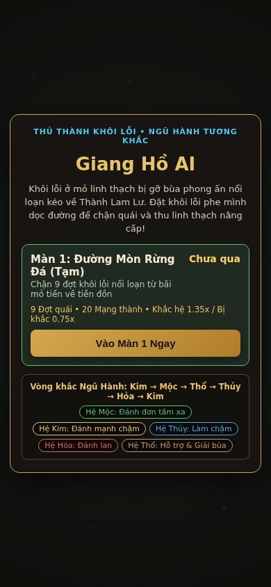
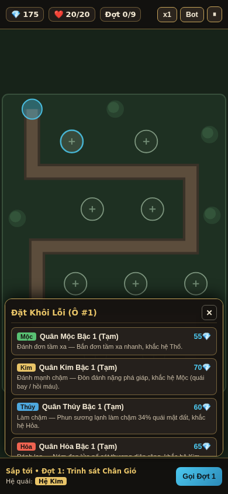
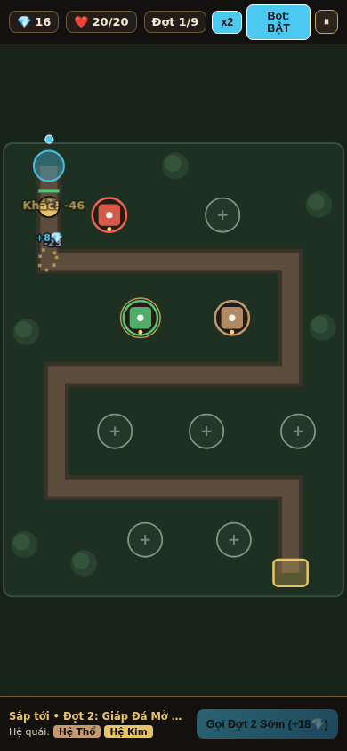

# Tiến độ phát triển — Giang Hồ AI (Đổi hướng: Game Thủ Thành)

Cập nhật: 22/11/2026 • Nhánh: `main` • Trạng thái hiện tại: **Màn 1 chơi được + Danh sách tên Thủ thành đã ghi vào `docs/NAMES.md` (chờ Claude rà `NAMES THỦ THÀNH: ĐỒNG Ý` và chơi thử chấm vui Màn 1)**.

---

## 1. Thứ tự làm (Theo `docs/ANTIGRAVITY_BRIEF_THU_THANH.md`)

### Bước 1: Danh sách tên mới & Lõi game thủ thành
- Đã ghi mục **"Thủ thành — Danh sách tên đề xuất (Chờ Claude rà)"** (mục 16, 17, 18) vào [`docs/NAMES.md`](NAMES.md):
  - **5 loại quân (5 hệ Ngũ Hành, 5 vai trò riêng, 3 bậc & 2 nhánh ở bậc 3):**
    1. **Mộc Tiêu Khôi** (Hệ Mộc — Đánh đơn tầm xa) → *Liên Tiêu Khôi* → *Truy Mạch Tiêu (3A)* / *Độc Căn Tiêu (3B)*.
    2. **Kim Trọng Khôi** (Hệ Kim — Đánh mạnh chậm, phá giáp) → *Phá Giáp Kim Khôi* → *Đoạt Lõi Cự Khôi (3A)* / *Xuyên Phong Kim Khôi (3B)*.
    3. **Thủy Hàn Khôi** (Hệ Thủy — Làm chậm diện rộng) → *Ngưng Sương Khôi* → *Băng Mạch Khôi (3A)* / *Triều Ngược Khôi (3B)*.
    4. **Hỏa Lôi Khôi** (Hệ Hỏa — Đánh lan) → *Viêm Bạo Khôi* → *Liệt Diệm Lò Khôi (3A)* / *Liên Hoàn Hỏa Khôi (3B)*.
    5. **Thổ Trấn Khôi** (Hệ Thổ — Hỗ trợ tăng công/tốc đánh & giải hiệu ứng phá bùa) → *Hoàng Thạch Trấn Khôi* → *Khu Ấn Thổ Khôi (3A)* / *Cộng Minh Thổ Khôi (3B)*.
  - **6 loại quái + 1 Trùm:** *Khôi Lỗi Chân Gió* (Kim — nhanh), *Thạch Giáp Khôi Lỗi* (Thổ — máu trâu), *Phi Dực Khôi Lỗi* (Mộc — bay / bỏ qua làm chậm), *Song Thể Khôi Lỗi* (Hỏa — chia đôi khi chết), *Phá Ấn Khôi Lỗi* (Thủy — khóa quân gần nó), *Linh Tuyền Khôi Lỗi* (Mộc — hồi máu cho bầy), và Trùm *Sơ Giác — Khôi Lỗi Thức Tỉnh* (Thủy).
  - **3 màn chơi:** *Đường Mòn Rừng Thạch Mạch* (Màn 1), *Ngã Đôi Lũng Đại Mạch* (Màn 2), *Trước Cổng Thành Lam Lư* (Màn 3).
- Trong lúc chờ `docs/REVIEW_LOG.md` có dòng `NAMES THỦ THÀNH: ĐỒNG Ý`, mã nguồn trong [`src/core/tdDefinitions.ts`](../src/core/tdDefinitions.ts) dùng tên tạm mô tả hệ và vai trò.
- Đã xoá toàn bộ các scene, giao diện và test nhập vai cũ khỏi nhánh `main` để code gọn nhẹ; giữ lại hệ thống Ngũ Hành [`src/core/elements.ts`](../src/core/elements.ts) (`1.35x` khi khắc / `0.75x` khi bị khắc), tổng hợp âm thanh Web Audio [`src/game/sound.ts`](../src/game/sound.ts) và lưu tiến độ vào khoá `localStorage` mới (`giang_ho_ai_thu_thanh_save_v1`) trong [`src/core/saveSystem.ts`](../src/core/saveSystem.ts).

### Bước 2: Màn 1 chơi được trên điện thoại cầm dọc (Chờ Claude chơi thử chấm vui)
- **Tuyến đường & Bố cục Màn 1 (`STAGE_1_DEFINITION`):**
  - Đường chữ S qua 2 khúc cua chữ U với 9 ô đặt quân (`pad_1` .. `pad_9`), 9 đợt quái với 4 loại quái (*Chân Gió — Kim*, *Giáp Đá — Thổ*, *Cánh Gỗ — Mộc*, *Song Lõi — Hỏa*), 20 mạng thành, 175 linh thạch khởi đầu.
  - Trước mỗi đợt, thanh dưới màn hình hiển thị rõ **biểu tượng hệ Ngũ Hành của đợt sắp tới** để người chơi tính đường đặt quân khắc chế.
  - Có nút **Gọi đợt sớm** (thưởng thêm linh thạch), nút **Tốc độ `x1 / x2`**, nút **Tạm dừng `⏸`**, và nút **Bot** tự đặt quân kiểm thử.
- **Cảm giác đánh & Giao diện điện thoại cầm dọc (`390×844`):**
  - Bản đồ chiếm phần lớn màn hình dọc; chạm vào ô trống mở bảng chọn 5 loại quân; chạm vào quân đã đặt để xem tầm bắn, nâng cấp Bậc 2 / chọn Nhánh A hoặc B ở Bậc 3, hoặc Bán thu hồi 70% linh thạch.
  - Số sát thương nảy lên tại chỗ, hiện chữ **"Khắc!"** màu vàng kim khi quân khắc hệ quái, quái chớp trắng khi trúng đạn, nổ mảnh khi chết, hạt linh thạch bay về góc trên trái màn hình, rung camera khi quái lọt vào thành làm mất mạng, kèm âm thanh Web Audio.
- **Kiểm thử cân bằng & độ vui (`tests/tdEngine.test.ts`, `e2e/game.spec.ts`):**
  - Kinh tế linh thạch Màn 1 được siết vừa đủ thắng khi phối hợp hệ và vị trí khúc cua, không thừa mứa để nâng tối đa mọi ô.
  - Chơi ẩu (chỉ đặt 1 loại quân hoặc đặt quá ít) chắc chắn **THUA** (mất hết 20 mạng).
  - Phối hợp đủ 5 hệ quân + nâng cấp ở khúc cua (hoặc dùng Bot trong [`src/core/tdBot.ts`](../src/core/tdBot.ts)) sẽ **THẮNG** Màn 1 và chấm 1–3 sao theo mạng còn lại.

---

## 2. Ảnh chụp màn hình điện thoại cầm dọc (`390×844`)

- Màn hình mở đầu (chọn Màn 1 & bảng tra cứu vòng khắc Ngũ Hành):
  
- Chạm ô trống mở bảng chọn 5 loại quân Ngũ Hành:
  
- Giao tranh trên bản đồ dọc (quân bắn đạn ngũ hành, chữ "Khắc!", thanh máu quái, gọi đợt sớm & tốc độ x2):
  
- Thắng Màn 1 & chấm sao:
  

---

## 3. Lệnh kiểm tra nhanh

```bash
npm test          # 14/14 unit test (ngũ hành, nâng cấp 3 bậc 2 nhánh, bán 70%, làm chậm/bay/chia đôi/phá bùa, kinh tế & bot Màn 1)
npm run build     # Đóng gói web tĩnh vào dist/
npm run test:e2e  # Playwright điện thoại dọc 390x844: mở game -> vào Màn 1 -> chạm đặt quân -> chạy x2 hết 9 đợt -> thắng
```
